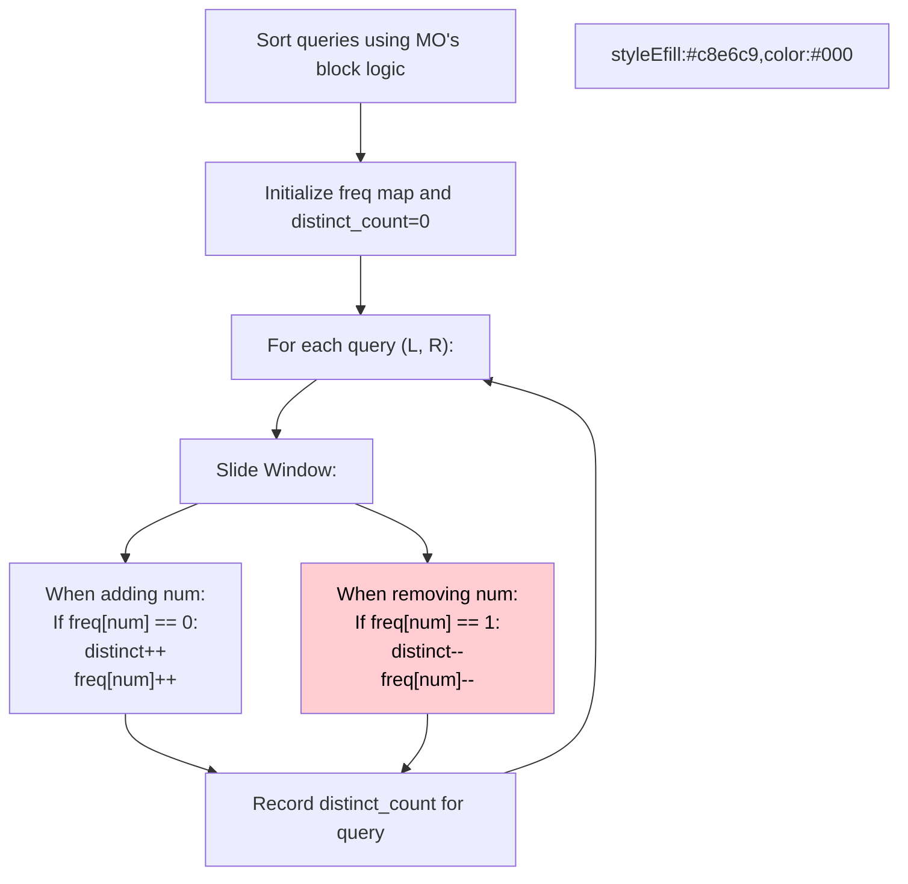

# 🚶‍♂️ Walkthrough: Range Distinct Elements

## 👶 Explain Like I'm 5
You have an array of numbers and are asked: "How many *unique* numbers are there between index L and index R?"
We can't use Prefix Sums because unique counts don't just add together (if a number appears twice, it only counts as one unique number).
Instead, we use MO's Algorithm! We keep a sliding window and a tally of how many times we've seen each number (`freq`).
When we add a number to our window, if it's the *first* time we've seen it (`freq == 0`), our `distinct_count` goes up!
When we remove a number from our window, if it drops to 0, our `distinct_count` goes down!
By sorting the queries smartly, we slide our window the minimum possible distance.

## 🎯 Core Strategy
**MO's Algorithm + Frequency Map**.

1. **Sort Queries**: Sort by `(L // sqrt(N), R)` just like standard MO's.
2. **State Variables**: Maintain a Hash Map `freq` and an integer `distinct_count = 0`.
3. **`add(num)` Function**:
   - Get current frequency of `num`.
   - If it's 0, `distinct_count += 1`.
   - Increment `freq[num]`.
4. **`remove(num)` Function**:
   - Get current frequency of `num`.
   - If it's 1, `distinct_count -= 1`.
   - Decrement `freq[num]`.
5. **Slide Pointers**: For each query `(L, R)`, adjust `curr_L` and `curr_R` by calling `add` or `remove` as needed until the window exactly matches `[L, R]`.

## 🏃‍♂️ Step-by-Step Execution (Dry Run)
**Input**: `nums = [1, 1, 2, 1, 3]`, `queries = [[0, 4], [0, 1], [1, 4]]`
N = 5. Block size = $\sqrt{5} = 2$.

**Sort Queries**:
- `[0, 1]`: Block 0, R=1.
- `[0, 4]`: Block 0, R=4.
- `[1, 4]`: Block 0, R=4.
Sorted: `[0, 1]`, `[0, 4]`, `[1, 4]`.

**Process**:
- Start: `freq = {}`, `distinct = 0`, `curr_L=0, curr_R=-1`.
- **Query `[0, 1]`**:
  - Add `nums[0]=1`: freq={1:1}, distinct=1.
  - Add `nums[1]=1`: freq={1:2}, distinct=1.
  - Result for `[0, 1]` is 1.
- **Query `[0, 4]`**:
  - Add `nums[2]=2`: freq={1:2, 2:1}, distinct=2.
  - Add `nums[3]=1`: freq={1:3, 2:1}, distinct=2.
  - Add `nums[4]=3`: freq={1:3, 2:1, 3:1}, distinct=3.
  - Result for `[0, 4]` is 3.
- **Query `[1, 4]`**:
  - Remove `nums[0]=1`: freq={1:2, 2:1, 3:1}, distinct=3.
  - Result for `[1, 4]` is 3.

Result array = `[3, 1, 3]` (in original order). ✅

## 📊 Visual Diagram

## 🛑 Complexity
- **Time:** $O(Q \log Q + Q \sqrt{N})$
- **Space:** $O(N + Q)$ — Map can grow up to size N, queries size Q.
