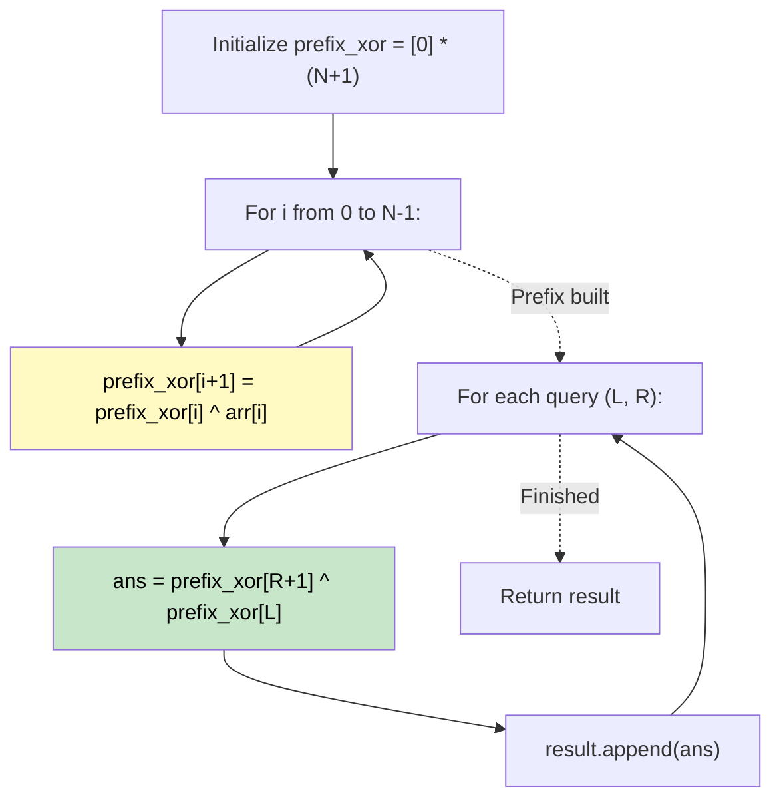

# 🚶‍♂️ Walkthrough: XOR Queries of a Subarray

## 👶 Explain Like I'm 5
You have an array of numbers, and you want to find the XOR sum from index L to R.
XOR is a cool math operation where doing it twice undoes itself! (Like flipping a light switch: flip it once, it changes; flip it again, it goes back).
So, if you want the XOR from index 2 to 4, you can just take the XOR of *everything* from index 0 to 4, and then XOR it with everything from index 0 to 1! The overlapping parts (0 to 1) will cancel themselves out, leaving only 2 to 4!
This is exactly like Prefix Sum, but with XOR instead of addition! (MO's algorithm is overkill here).

## 🎯 Core Strategy
**Prefix XOR**.

1. Create a `prefix_xor` array of size `N + 1` filled with 0s.
2. Iterate through the array: `prefix_xor[i + 1] = prefix_xor[i] ^ arr[i]`.
   - This means `prefix_xor[k]` stores the XOR of all elements from index 0 up to `k-1`.
3. For each query `[L, R]`:
   - The answer is simply `prefix_xor[R + 1] ^ prefix_xor[L]`.
   - The elements from index 0 to L-1 are XORed twice and cancel out perfectly!
4. Return the results.

## 🏃‍♂️ Step-by-Step Execution (Dry Run)
**Input**: `arr = [1, 3, 4, 8]`, `queries = [[0, 1], [1, 2], [0, 3], [3, 3]]`

**Build Prefix XOR**:
- `prefix_xor[0] = 0`
- `prefix_xor[1] = 0 ^ 1 = 1`
- `prefix_xor[2] = 1 ^ 3 = 2`
- `prefix_xor[3] = 2 ^ 4 = 6`
- `prefix_xor[4] = 6 ^ 8 = 14`
`prefix_xor = [0, 1, 2, 6, 14]`

**Answer Queries**:
- `[0, 1]`: `prefix_xor[2] ^ prefix_xor[0]` = 2 ^ 0 = **2**. (1^3=2).
- `[1, 2]`: `prefix_xor[3] ^ prefix_xor[1]` = 6 ^ 1 = **7**. (3^4=7).
- `[0, 3]`: `prefix_xor[4] ^ prefix_xor[0]` = 14 ^ 0 = **14**. (1^3^4^8=14).
- `[3, 3]`: `prefix_xor[4] ^ prefix_xor[3]` = 14 ^ 6 = **8**. (8=8).

Result = `[2, 7, 14, 8]` ✅

## 📊 Visual Diagram

## 🛑 Complexity
- **Time:** $O(N + Q)$ — O(N) to build the prefix array, O(1) per query.
- **Space:** $O(N)$ for the `prefix_xor` array.
