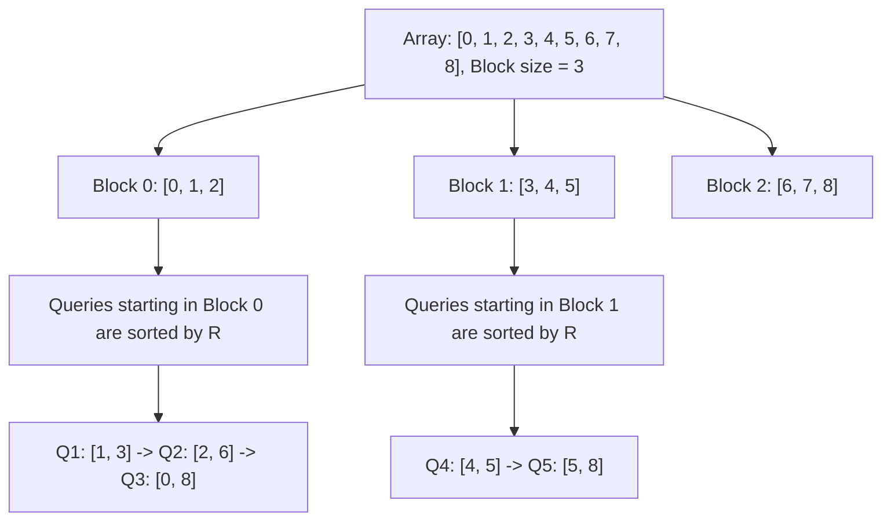

# Pattern 37: MO's Algorithm (Square Root Decomposition)

## 👶 Explain Like I'm 5

Imagine you have a long bookshelf. Someone keeps asking you questions like:
"How many *different* books are there between shelf 2 and shelf 8?"
"How many between shelf 1 and 3?"
"How many between shelf 5 and 9?"

If you walk back and forth for every question, you'll get very tired.
What if you collected ALL the questions first (Offline Queries), sorted them
so you answer questions about shelf 1-3, then 2-8, then 5-9?
By slightly moving your "start" and "end" pointers, you reuse the work from the
previous question!
**MO's Algorithm** perfectly sorts these questions into "Blocks" so your pointers
move the absolute minimum distance possible.

---

## 🧩 Core Idea & Pattern Detection

MO's Algorithm is used for **Offline Range Queries**.
"Offline" means you are given all the queries up front and you don't have to answer
them in the order they were asked.

### How it works:
1. Divide the array of size `N` into blocks of size `sqrt(N)`.
2. Sort the queries.
   - Primary sort: The block index of the Left pointer (`L // sqrt(N)`).
   - Secondary sort: The Right pointer (`R`).
3. Maintain two pointers, `current_L` and `current_R`, and a sliding window state.
4. For each sorted query, `add` or `remove` elements by moving `current_L` and `current_R`
   until they match the query's `L` and `R`.

### When to use it:
- Processing many range queries where `add(element)` and `remove(element)` are O(1).
- Questions asking for "Distinct elements in range [L, R]" or "Mode in range [L, R]".
- Keywords: "queries", "offline", "distinct elements in subarray".

---

## 🔧 Visual Anatomy

Sorting Queries into Blocks:

---

## ⏱️ Complexity Analysis

| Scenario | Time | Space |
|----------|------|-------|
| MO's Algorithm | O((N + Q) * sqrt(N)) | O(N) |

The right pointer moves continuously forward inside a block.
The left pointer only moves `sqrt(N)` steps per query.

---

## ✅ Problems in This Pattern

| # | Problem | Difficulty | Note |
|---|---------|------------|------|
| 1 | Range Sum Query (MO's Intro) | Medium | Illustrates the pointers |
| 2 | Range Distinct Elements | Hard | The classic use-case |
