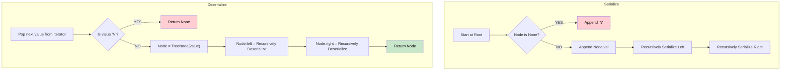

# 🚶‍♂️ Walkthrough: Serialize and Deserialize Binary Tree

## 👶 Explain Like I'm 5
Imagine you build a beautiful Lego tree. You want to mail it to your friend, but it won't fit in the box! You have to take it apart piece by piece, and write down exactly how to put it back together.
You start at the top, write down the piece, go to the left, write it down, go to the right, write it down. 
The secret trick: Whenever there is NO piece (a branch ends), you write down "N". If you don't write "N", your friend won't know if the next piece goes on the left or the right!

## 🎯 Core Strategy
**Pre-order Traversal (DFS) with Null Markers**.

1. **Serialize**: Use a Depth First Search (Pre-order: Root, Left, Right). 
   - If the node exists, append its value to a list.
   - If the node is `None`, append a special marker like `"N"`.
   - Join the list with commas to make a string (e.g., `"1,2,N,N,3,4,N,N,5,N,N"`).
2. **Deserialize**: Split the string by commas into an iterator (so we can just pop the next value easily).
   - Get the next value.
   - If it's `"N"`, return `None`.
   - Otherwise, create a `TreeNode` with the value.
   - Recursively call the function to build its `left` child, then its `right` child.
   - Return the node.

## 🏃‍♂️ Step-by-Step Execution (Dry Run)
**Tree**:
```
      1
     / \
    2   3
```

**Serialize**:
- `dfs(1)`: Add "1", call left, call right.
- `dfs(2)`: Add "2", call left, call right.
- `dfs(None)` (left of 2): Add "N".
- `dfs(None)` (right of 2): Add "N".
- Back to 1, now right side: `dfs(3)`: Add "3", call left, call right.
- `dfs(None)`: Add "N".
- `dfs(None)`: Add "N".
Result: `"1,2,N,N,3,N,N"`

**Deserialize**:
`vals = ["1", "2", "N", "N", "3", "N", "N"]`
- `dfs()`: gets "1". `node = TreeNode(1)`.
  - `node.left = dfs()`: gets "2". `node2 = TreeNode(2)`.
    - `node2.left = dfs()`: gets "N". Returns None.
    - `node2.right = dfs()`: gets "N". Returns None.
    - Returns `node2` up. So 1's left is 2.
  - `node.right = dfs()`: gets "3". `node3 = TreeNode(3)`.
    - `node3.left = dfs()`: gets "N". Returns None.
    - `node3.right = dfs()`: gets "N". Returns None.
    - Returns `node3` up. So 1's right is 3.
- Returns root (1). Tree perfectly restored! ✅

## 📊 Visual Diagram



## 🛑 Complexity
- **Time:** $O(N)$ for both serialization and deserialization.
- **Space:** $O(N)$ for the recursion stack and the string/array storage.
