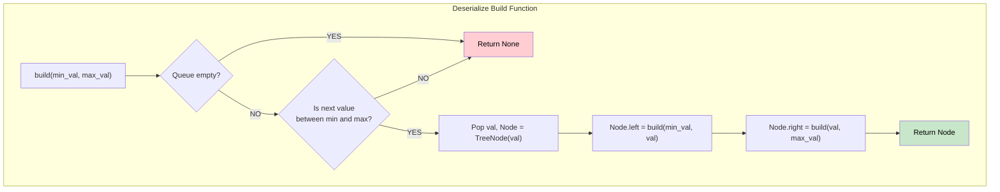

# 🚶‍♂️ Walkthrough: Serialize and Deserialize BST

## 👶 Explain Like I'm 5
Last time, we wrote "N" to remember where empty spots were in our tree. 
But if the tree is a Binary *Search* Tree (BST), the numbers are organized! Small numbers on the left, big numbers on the right.
Because of this rule, we *don't even need* the "N"s! We can just write out the numbers: "5,3,2,4,7,8". 
When we rebuild it, if we are at 5 and we read a 3, we know 3 is smaller, so it MUST go on the left! If we read a 7, it's bigger, so it MUST go on the right. 

## 🎯 Core Strategy
**Pre-order DFS + Min/Max Boundaries**.

1. **Serialize**: Same as a normal binary tree, but DO NOT append `"N"` for null nodes. Just ignore them. We get a simple string of numbers.
2. **Deserialize**: 
   - Convert the string into a queue of numbers.
   - Create a recursive `build` function that takes a `min_val` and `max_val`.
   - If the queue is empty, or if the next number in the queue does NOT fall between `min_val` and `max_val`, then this number doesn't belong here! Return `None`.
   - Otherwise, pop the number and create a `TreeNode`.
   - Build its left child by giving it a stricter `max_val` (it must be smaller than the current node).
   - Build its right child by giving it a stricter `min_val` (it must be larger than the current node).

## 🏃‍♂️ Step-by-Step Execution (Dry Run)
**BST**:
```
    5
   / \
  3   7
```

**Serialize**: Just "5,3,7" (Pre-order, no Nulls).

**Deserialize**: `vals = [5, 3, 7]`
- `build(-inf, inf)`:
  - `5` is between `-inf` and `inf`. Pop `5`. `node = 5`.
  - `node.left = build(-inf, 5)`
    - Next val is `3`. `3` is between `-inf` and `5`. Pop `3`. `node = 3`.
    - `node.left = build(-inf, 3)`
      - Next val is `7`. `7` is NOT between `-inf` and `3`! Return None. (No left child for 3).
    - `node.right = build(3, 5)`
      - Next val is `7`. `7` is NOT between `3` and `5`! Return None. (No right child for 3).
    - Return `3` node up.
  - `node.right = build(5, inf)`
    - Next val is `7`. `7` is between `5` and `inf`. Pop `7`. `node = 7`.
    - (Left and right calls for 7 will see empty queue and return None).
    - Return `7` node up.
- Return `5` node! Tree perfectly restored! ✅

## 📊 Visual Diagram



## 🛑 Complexity
- **Time:** $O(N)$ for both! We process each value in the array exactly once.
- **Space:** $O(N)$ to store the array and recursion stack. More memory efficient than standard Binary Tree serialization since we omit `N` markers!
