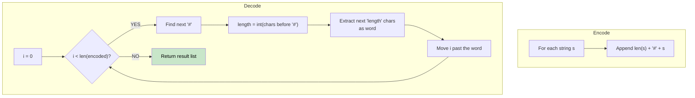

# 🚶‍♂️ Walkthrough: Encode and Decode Strings

## 👶 Explain Like I'm 5
You want to send a list of words, like `["Cat", "Dog"]`, as a single long sentence.
If you just smash them together: `"CatDog"`, how do you split them back?
If you put commas between them: `"Cat,Dog"`, what if the word itself has a comma in it? Like `["Hello, friend", "Dog"]` -> `"Hello, friend,Dog"`. How do we split it without messing up the first word?
The trick: Count the letters! Before each word, write a number saying how long it is, followed by a special symbol like `#`.
`["Cat", "Dog"]` -> `"3#Cat3#Dog"`.
When decoding, you read the number, see the `#`, and say "Okay, I need to grab exactly the next 3 letters!". Then you repeat.

## 🎯 Core Strategy
**Length Prefixing**.

1. **Encode**: Iterate through the list of strings. For each string `s`, calculate its length. Append `length`, followed by a delimiter like `#`, followed by the string `s`. Join them all together.
2. **Decode**: Use a `while` loop with a pointer `i` starting at 0.
   - Look ahead to find the `#` delimiter.
   - The substring before the `#` is the length of the upcoming word. Convert it to an integer.
   - Jump past the `#`. The word starts here, and it ends exactly `length` characters later.
   - Slice out the word and append it to our result list.
   - Move `i` to the end of that word and repeat!

## 🏃‍♂️ Step-by-Step Execution (Dry Run)
**Input**: `strs = ["Hello", "12#World!"]`

**Encode**:
- "Hello": length is 5. Result += `"5#Hello"`
- "12#World!": length is 9. Result += `"9#12#World!"`
Encoded String: `"5#Hello9#12#World!"`

**Decode**: `"5#Hello9#12#World!"`
- `i = 0`. Find `#`. It's at index 1.
  - Length is `int("5")` = 5.
  - String starts at index 2, goes to 2+5 = 7.
  - Word is `"Hello"`.
  - Move `i = 7`.
- `i = 7`. Find `#`. It's at index 8 (the string here is `"9#12#World!"`).
  - Length is `int("9")` = 9.
  - String starts at index 9, goes to 9+9 = 18.
  - Word is `"12#World!"`.
  - Move `i = 18` (End of string).

Result = `["Hello", "12#World!"]` ✅

## 📊 Visual Diagram

## 🛑 Complexity
- **Time:** $O(N)$ where $N$ is the total number of characters across all strings.
- **Space:** $O(N)$ to store the encoded string and the decoded output list.
