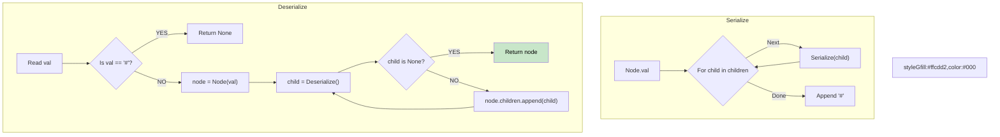

# 🚶‍♂️ Walkthrough: Serialize and Deserialize N-ary Tree

## 👶 Explain Like I'm 5
In an N-ary tree, a parent node can have 1 child, 5 children, or 0 children!
When writing out the tree, we write the parent, then all its children. But how do we know when we are done listing its children and it's time to move on?
We just put a "stop sign" (like a `#`) after the last child! 
So we write: `[Parent, Child1, Child2, #]`. When we rebuild it, we keep attaching children to the parent until we hit the `#`.

## 🎯 Core Strategy
**Pre-order DFS with End-of-Children Sentinels**.

1. **Serialize**: Use DFS.
   - Append `node.val` to the result list.
   - Recursively call DFS on every child in `node.children`.
   - After the loop finishes (all children processed), append a sentinel value: `"#"`!
   - Join with commas.
2. **Deserialize**: Split string into an iterator.
   - Read the next value.
   - If it's `"#"` (the sentinel), return `None`.
   - Otherwise, create a `Node(val)`.
   - Enter a `while True` loop: try to parse a child by calling DFS recursively.
   - If the recursive call returns `None`, it means it hit the `#` sentinel for *this* node! Break the loop.
   - Otherwise, append the child to `node.children`.
   - Return the node.

## 🏃‍♂️ Step-by-Step Execution (Dry Run)
**Tree**:
```
    1
   / \
  2   3
```
(Node 1 has two children. Nodes 2 and 3 have zero children).

**Serialize**:
- `dfs(1)`: Append `1`.
  - `dfs(2)`: Append `2`. Children loop empty. Append `#`.
  - `dfs(3)`: Append `3`. Children loop empty. Append `#`.
- `dfs(1)` children loop done. Append `#`.
Result string: `"1,2,#,3,#,#"`

**Deserialize**: `iter(["1", "2", "#", "3", "#", "#"])`
- `dfs()` reads "1". `node = Node(1)`. Loop for children:
  - `child = dfs()` reads "2". `node2 = Node(2)`. Loop for children:
    - `child_of_2 = dfs()` reads "#". Returns `None`. Break loop.
    - Return `node2`.
  - Back to node 1. Append `node2` to 1's children.
  - `child = dfs()` reads "3". `node3 = Node(3)`. Loop for children:
    - `child_of_3 = dfs()` reads "#". Returns `None`. Break loop.
    - Return `node3`.
  - Back to node 1. Append `node3` to 1's children.
  - `child = dfs()` reads "#". Returns `None`. Break loop.
- Return `node`. Tree perfectly restored! ✅

## 📊 Visual Diagram



## 🛑 Complexity
- **Time:** $O(N)$
- **Space:** $O(N)$
