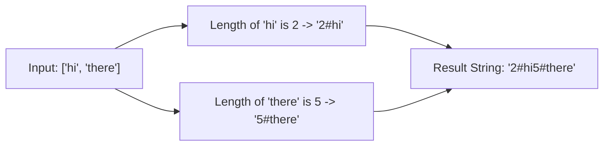

# Pattern 38: Serialize and Deserialize

## 👶 Explain Like I'm 5

Imagine you built a really cool Lego castle (a Data Structure like a Tree).
You want to mail it to your friend, but the post office only accepts flat boxes.
So, you have to break the castle into individual blocks and write down an
instruction manual on how to rebuild it (**Serialization**).
Your friend receives the box of blocks and the manual, and rebuilds the exact
same castle (**Deserialization**).

---

## 🧩 Core Idea & Pattern Detection

Serialization converts complex, pointer-based data structures (like Trees, Graphs,
or Lists of Strings) into a flat String or Byte Array so they can be saved to disk
or sent over a network.
Deserialization is the reverse process.

### Common Approaches:
1. **Pre-order Traversal (DFS)**: Great for Binary Trees. You visit the root, left, then right. You MUST record `null` nodes (e.g., using "N") so the structure can be uniquely rebuilt!
2. **Level-order Traversal (BFS)**: Also works for Trees, recording nodes level by level.
3. **Length Prefixing**: Great for strings. If you have "hello" and "world", serialize them as "5#hello5#world". This completely avoids issues with delimiter collisions!

### When to use it:
- Storing a Tree/Graph in a database.
- Sending a list of strings safely over a network.
- Keywords: "serialize", "deserialize", "encode", "decode".

---

## 🔧 Visual Anatomy

Length Prefixing for Arrays of Strings:

When decoding, read the number until you hit `#`, then grab exactly that many characters!

---

## ⏱️ Complexity Analysis

| Scenario | Time | Space |
|----------|------|-------|
| Trees (DFS/BFS) | O(N) | O(N) to store the string/recursion stack |
| Strings (Prefixing) | O(N) total chars | O(N) to store the result |

---

## ✅ Problems in This Pattern

| # | Problem | Difficulty | LeetCode |
|---|---------|------------|----------|
| 1 | Serialize & Deserialize Binary Tree | Hard | #297 |
| 2 | Serialize & Deserialize BST | Medium | #449 |
| 3 | Encode & Decode Strings | Medium | #271 |
