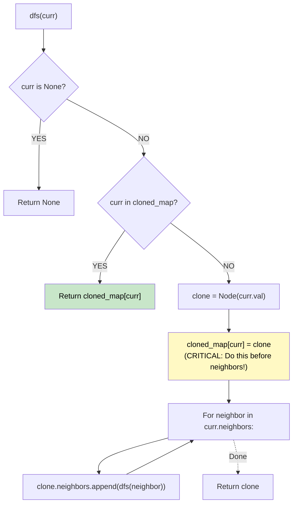

# 🚶‍♂️ Walkthrough: Clone Graph

## 👶 Explain Like I'm 5
Imagine you have a map of cities connected by roads. You need to draw an *exact copy* of this map on a new piece of paper.
If you just trace a city and its roads, you might accidentally draw the same city twice when you reach it from a different road!
To fix this, you keep a notebook: "Original City A -> New City A". 
Whenever you visit a city, you check your notebook. If it's already there, you just draw a road to the New City you already created! If not, you create a New City, write it in your notebook IMMEDIATELY, and then explore its roads.

## 🎯 Core Strategy
**DFS + Hash Map (Visited/Cloned Registry)**.

1. **Hash Map**: Initialize a dictionary `cloned_map` that maps an original `Node` to its newly created clone `Node`. This prevents infinite loops in cycles and ensures we don't duplicate nodes.
2. **DFS Function**:
   - If the current node is `None`, return `None`.
   - If the current node is already in `cloned_map`, return the clone we already made! `return cloned_map[curr]`.
   - Otherwise, create a new clone: `clone = Node(curr.val)`.
   - **Crucial Step**: Add `curr -> clone` to `cloned_map` IMMEDIATELY. We must do this *before* visiting neighbors to handle cycles correctly!
   - Loop through `curr.neighbors`. For each neighbor, recursively call DFS and append the result to `clone.neighbors`.
3. Return the DFS result starting from the given node.

## 🏃‍♂️ Step-by-Step Execution (Dry Run)
**Graph**: 1 is connected to 2 and 4. 2 is connected to 1 and 3. (A square).

- `dfs(1)`: 
  - `1` not in map. `clone1 = Node(1)`. Map: `{1: clone1}`.
  - Neighbors of 1: [2, 4].
  - Visit 2: `dfs(2)`.
    - `2` not in map. `clone2 = Node(2)`. Map: `{1: clone1, 2: clone2}`.
    - Neighbors of 2: [1, 3].
    - Visit 1: `dfs(1)`. `1` IS in map! Return `clone1`. (clone2's neighbor is now clone1).
    - Visit 3: `dfs(3)`.
      - `3` not in map. `clone3 = Node(3)`. Map: `{1: c1, 2: c2, 3: c3}`.
      - Neighbors of 3: [2, 4].
      - Visit 2: `dfs(2)` returns `clone2`.
      - Visit 4: `dfs(4)`.
        - `4` not in map. `clone4 = Node(4)`. Map: `{1:c1, 2:c2, 3:c3, 4:c4}`.
        - Neighbors of 4: [1, 3].
        - Visit 1: returns `clone1`.
        - Visit 3: returns `clone3`.
        - `clone4` neighbors = [clone1, clone3]. Returns `clone4`.
      - `clone3` neighbors = [clone2, clone4]. Returns `clone3`.
    - `clone2` neighbors = [clone1, clone3]. Returns `clone2`.
  - Visit 4: `dfs(4)`. `4` IS in map! Return `clone4`.
  - `clone1` neighbors = [clone2, clone4]. Returns `clone1`.

Result = `clone1` ✅ (Deep copy created, cycles preserved).

## 📊 Visual Diagram

## 🛑 Complexity
- **Time:** $O(V + E)$ where $V$ is number of vertices and $E$ is number of edges. We visit every vertex and edge exactly once.
- **Space:** $O(V)$ for the hash map and the recursion stack.
