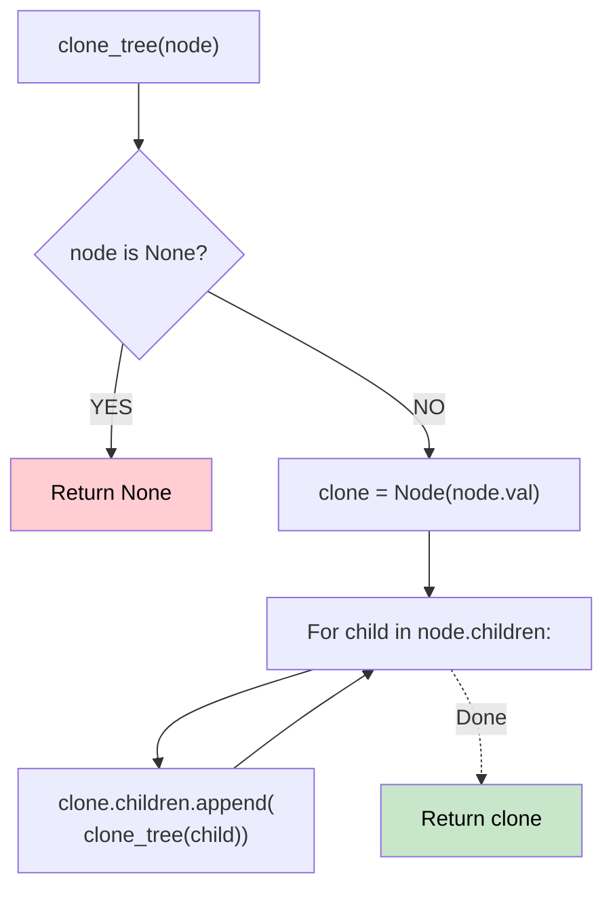

# 🚶‍♂️ Walkthrough: Clone N-ary Tree

## 👶 Explain Like I'm 5
You have a tree where a parent can have many children (an N-ary tree). You need to make a perfect copy of it.
This is exactly like cloning a Graph, but EASIER! 
Why? Because trees don't have cycles! You can never travel down a tree and accidentally end up back where you started.
Because there are no cycles, we don't even need a notebook (Hash Map) to keep track of what we've already cloned! We just clone the node, clone its children, and attach them.

## 🎯 Core Strategy
**Pure Recursive DFS (No Hash Map needed)**.

1. If the `root` is `None`, return `None`.
2. Create a new `clone` node with `root.val`.
3. For every `child` in `root.children`:
   - Recursively call `clone_tree(child)`.
   - Append the result to `clone.children`.
4. Return `clone`.

## 🏃‍♂️ Step-by-Step Execution (Dry Run)
**Tree**:
```
    1
   / \
  3   2
 / \
5   6
```

- `clone_tree(1)`:
  - `clone1 = Node(1)`.
  - Loop children: [3, 2].
  - `clone_tree(3)`:
    - `clone3 = Node(3)`.
    - Loop children: [5, 6].
    - `clone_tree(5)`: returns `Node(5)` (no children).
    - `clone3` children = `[Node(5)]`.
    - `clone_tree(6)`: returns `Node(6)` (no children).
    - `clone3` children = `[Node(5), Node(6)]`.
    - returns `clone3`.
  - `clone1` children = `[clone3]`.
  - `clone_tree(2)`:
    - `clone2 = Node(2)` (no children).
    - returns `clone2`.
  - `clone1` children = `[clone3, clone2]`.
- returns `clone1`. ✅

## 📊 Visual Diagram



## 🛑 Complexity
- **Time:** $O(N)$ — Visit every node exactly once.
- **Space:** $O(N)$ — For the recursion stack and the newly allocated tree nodes.
