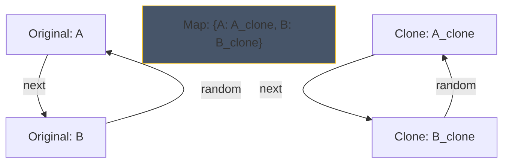

# Pattern 39: Clone Pattern (Deep Copy)

## 👶 Explain Like I'm 5

Imagine you have a complicated spider web of connected Lego pieces (a Graph).
You want to build an EXACT replica of it.
If you just pick up a red Lego from the original web and place it in your new web,
you ruined the original web! (That's a Shallow Copy).

To make a true **Deep Copy**, you need to look at a piece in the original web,
buy a brand new piece that looks exactly like it, and put it in your new web.
But wait! How do you remember which original piece matches which new piece so you
can connect them properly?
You keep a notebook (a Hash Map): "Original Red Lego -> New Red Lego".

---

## 🧩 Core Idea & Pattern Detection

The **Clone Pattern** is all about traversing a pointer-based data structure
(like a Graph or a Linked List with random pointers) and creating a deep copy.
Because the structure can have cycles (loops), if you aren't careful, you will
get stuck in an infinite loop creating infinite new nodes!

### The Golden Rule: The Hash Map
Always use a Hash Map to map `Original Node -> Cloned Node`.
1. When you visit a node, check the Hash Map.
2. If it's already there, just return the cloned node! (This prevents infinite loops).
3. If not, create a new node, put it in the Hash Map immediately, and then
   recursively clone its neighbors/children.

### When to use it:
- "Deep copy" of a Graph.
- "Copy List with Random Pointer".
- Keywords: "clone", "deep copy", "random pointer".

---

## 🔧 Visual Anatomy

Cloning a Linked List with a Random Pointer:

---

## ⏱️ Complexity Analysis

| Scenario | Time | Space |
|----------|------|-------|
| Clone Graph | O(V + E) | O(V) for Hash Map + Call Stack |
| Copy List w/ Random | O(N) | O(N) for Hash Map |

*(Note: Copy List with Random Pointer can also be done in O(1) space by weaving the cloned nodes into the original list, which is a brilliant trick!)*

---

## ✅ Problems in This Pattern

| # | Problem | Difficulty | LeetCode |
|---|---------|------------|----------|
| 1 | Clone Graph | Medium | #133 |
| 2 | Copy List with Random Pointer | Medium | #138 |
