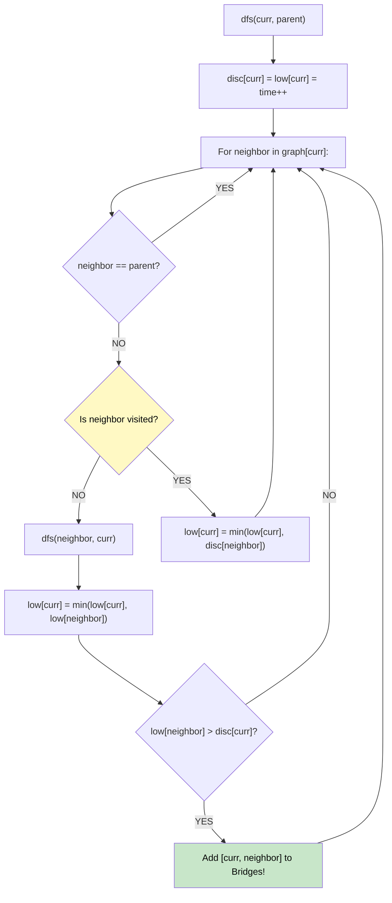

# 🚶‍♂️ Walkthrough: Critical Connections in a Network

## 👶 Explain Like I'm 5
Imagine you have a bunch of cities connected by bridges. A "critical connection" is a bridge that, if it breaks, leaves some cities totally disconnected from each other.
If a bridge is part of a loop (a cycle), it's *never* critical, because if it breaks, you can just go the long way around the loop!
To find critical bridges, we send an explorer to walk through the cities. The explorer keeps a timer. Whenever he visits a city, he writes down the time. He also writes down the *earliest* time he could possibly jump back to using a back-alley (a back-edge).
If he walks over a bridge to City B, and City B CANNOT find a back-alley to a city earlier than City B's own discovery time, that means City B is a dead-end without that bridge! That bridge is critical!

## 🎯 Core Strategy
**Tarjan's Bridge-Finding Algorithm (DFS)**.

1. **Build Graph**: Convert the edge list into an adjacency list `graph`.
2. **State Tracking**: Keep arrays for `discovery_time` and `lowest_reachable_time`. Initialize with -1. Keep a global `time` counter.
3. **DFS**:
   - `dfs(node, parent)`: Set discovery and lowest time to the current `time`. Increment `time`.
   - Iterate through neighbors.
   - Ignore the `parent` (the node we just came from).
   - If neighbor is Unvisited:
     - Recursively `dfs(neighbor, node)`.
     - After returning, update `lowest_reachable_time[node] = min(node's lowest, neighbor's lowest)`.
     - **BRIDGE CHECK**: If `lowest_reachable_time[neighbor] > discovery_time[node]`, the neighbor couldn't reach anything earlier than itself! The edge `[node, neighbor]` is a bridge!
   - If neighbor IS Visited:
     - We found a back-edge! Update `lowest_reachable_time[node] = min(node's lowest, neighbor's discovery_time)`.

## 🏃‍♂️ Step-by-Step Execution (Dry Run)
**Graph**: `0 - 1 - 2 - 0` (Cycle) and `1 - 3` (Bridge).

- `dfs(0, parent -1)`:
  - `time = 0`. `disc[0]=0, low[0]=0`.
  - Neighbors: 1, 2. Visit 1.
  - `dfs(1, parent 0)`:
    - `time = 1`. `disc[1]=1, low[1]=1`.
    - Neighbors: 0, 2, 3. Skip 0 (parent). Visit 2.
    - `dfs(2, parent 1)`:
      - `time = 2`. `disc[2]=2, low[2]=2`.
      - Neighbors: 1, 0. Skip 1 (parent).
      - Neighbor 0 is visited! Back-edge!
      - `low[2] = min(low[2], disc[0]) = min(2, 0) = 0`.
    - Back to 1. `low[1] = min(low[1], low[2]) = min(1, 0) = 0`.
    - Is `low[2] > disc[1]`? `0 > 1` False. Not a bridge.
    - Visit 3.
    - `dfs(3, parent 1)`:
      - `time = 3`. `disc[3]=3, low[3]=3`.
      - Neighbors: 1. Skip 1 (parent).
    - Back to 1. `low[1] = min(0, 3) = 0`.
    - Is `low[3] > disc[1]`? `3 > 1` TRUE! `[1, 3]` is a Bridge!
- Back to 0. `low[0] = min(0, 0) = 0`.
- Return `[[1, 3]]`. ✅

## 📊 Visual Diagram

## 🛑 Complexity
- **Time:** $O(V + E)$ where V is servers and E is connections. A single DFS visits everything.
- **Space:** $O(V + E)$ to build the graph and recursion stack.
