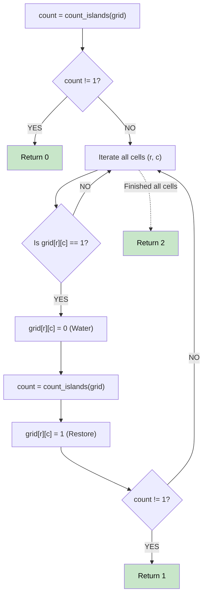

# 🚶‍♂️ Walkthrough: Minimum Number of Days to Disconnect Island

## 👶 Explain Like I'm 5
You have an island on a grid. You want to split the island into two separate islands by digging up pieces of land. How many pieces do you need to dig up?
Here's a secret: It will ALWAYS take either 0, 1, or 2 days! Never more!
- 0 days: If it's already split, or there is no island!
- 1 day: If there is a single "weak point" (an Articulation Point) that breaks the island if you remove it.
- 2 days: If there are no weak points, you can ALWAYS just chop off a corner of the island by removing the 2 blocks next to it!

## 🎯 Core Strategy
**Brute Force Articulation Point (Grid)**.

While we *could* use Tarjan's algorithm for Articulation Points, the grid is small enough (at most 30x30) that we can just use Brute Force!
1. **Count Islands**: Write a helper function that counts how many distinct islands exist on the grid (using standard BFS/DFS).
2. **Check 0 Days**: Call `count_islands()`. If it's `!= 1` (meaning 0 islands, or 2+ islands), return 0!
3. **Check 1 Day**: Loop over every single cell in the grid.
   - If it's land (`1`), temporarily change it to water (`0`).
   - Call `count_islands()`.
   - If it's `!= 1` (it split the island, or destroyed the only land cell), return 1!
   - Change the cell back to land (`1`).
4. **Return 2**: If you tried removing every single block and none of them broke the island, return 2!

## 🏃‍♂️ Step-by-Step Execution (Dry Run)
**Grid**:
```
0 1 1 0
0 1 1 0
```
- `count_islands()`: Returns 1. (It's a 2x2 square).
- Loop cells:
  - Remove (0,1): Grid becomes an L-shape. `count_islands()` = 1. Restore.
  - Remove (0,2): Grid becomes backward L-shape. `count_islands()` = 1. Restore.
  - Remove (1,1): `count_islands()` = 1. Restore.
  - Remove (1,2): `count_islands()` = 1. Restore.
- None of the single removals disconnected the island.
- Return 2. ✅ (Removing (0,1) and (1,2) would leave two disconnected cells!).

## 📊 Visual Diagram



## 🛑 Complexity
- **Time:** $O( (R \times C)^2 )$ — We run a BFS (which takes $O(R \times C)$) for every single land cell (up to $R \times C$ times). Since grid is up to 30x30 = 900, $900^2 \approx 810,000$ operations. Easily fits within time limits!
- **Space:** $O(R \times C)$ — Visited array and queue for BFS.
