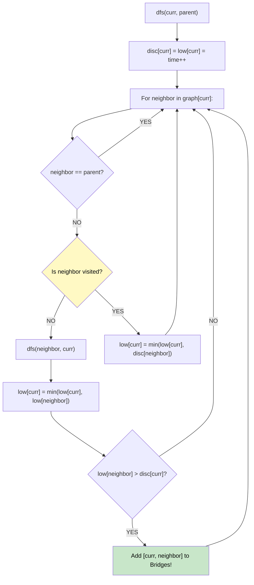

# 🚶‍♂️ Walkthrough: Find Bridges in a Graph

## 👶 Explain Like I'm 5
*(Note: This is exactly the same problem as "Critical Connections in a Network".)*
Imagine you have a bunch of cities connected by bridges. A "critical connection" is a bridge that, if it breaks, leaves some cities totally disconnected from each other.
To find critical bridges, we send an explorer to walk through the cities. The explorer keeps a timer. Whenever he visits a city, he writes down the time. He also writes down the *earliest* time he could possibly jump back to using a back-alley (a back-edge).
If he walks over a bridge to City B, and City B CANNOT find a back-alley to a city earlier than City B's own discovery time, that means City B is a dead-end without that bridge! That bridge is critical!

## 🎯 Core Strategy
**Tarjan's Bridge-Finding Algorithm (DFS)**.

1. **Build Graph**: Convert the edge list into an adjacency list `graph`.
2. **State Tracking**: Keep arrays for `discovery_time` and `lowest_reachable`. Initialize with -1. Keep a global `time` counter.
3. **DFS**:
   - `dfs(node, parent)`: Set discovery and lowest time to the current `time`. Increment `time`.
   - Iterate through neighbors.
   - Ignore the `parent` (the node we just came from).
   - If neighbor is Unvisited:
     - Recursively `dfs(neighbor, node)`.
     - After returning, update `lowest_reachable[node] = min(node's lowest, neighbor's lowest)`.
     - **BRIDGE CHECK**: If `lowest_reachable[neighbor] > discovery_time[node]`, the neighbor couldn't reach anything earlier than itself! The edge `[node, neighbor]` is a bridge!
   - If neighbor IS Visited:
     - We found a back-edge! Update `lowest_reachable[node] = min(node's lowest, discovery_time[neighbor])`.

## 🏃‍♂️ Step-by-Step Execution (Dry Run)
**Graph**: `0 - 1` and `1 - 2` (A simple line).

- `dfs(0, -1)`:
  - `disc[0]=0, low[0]=0`. Visit 1.
  - `dfs(1, 0)`:
    - `disc[1]=1, low[1]=1`. Visit 2.
    - `dfs(2, 1)`:
      - `disc[2]=2, low[2]=2`. No other neighbors.
    - Back to 1. `low[1] = min(1, 2) = 1`.
    - Is `low[2] > disc[1]`? (2 > 1). TRUE! `[1, 2]` is a bridge!
  - Back to 0. `low[0] = min(0, 1) = 0`.
  - Is `low[1] > disc[0]`? (1 > 0). TRUE! `[0, 1]` is a bridge!

Result: `[[1, 2], [0, 1]]` (or any order). ✅

## 📊 Visual Diagram

## 🛑 Complexity
- **Time:** $O(V + E)$ where V is nodes and E is edges. A single DFS visits everything.
- **Space:** $O(V + E)$ to build the graph and recursion stack.
