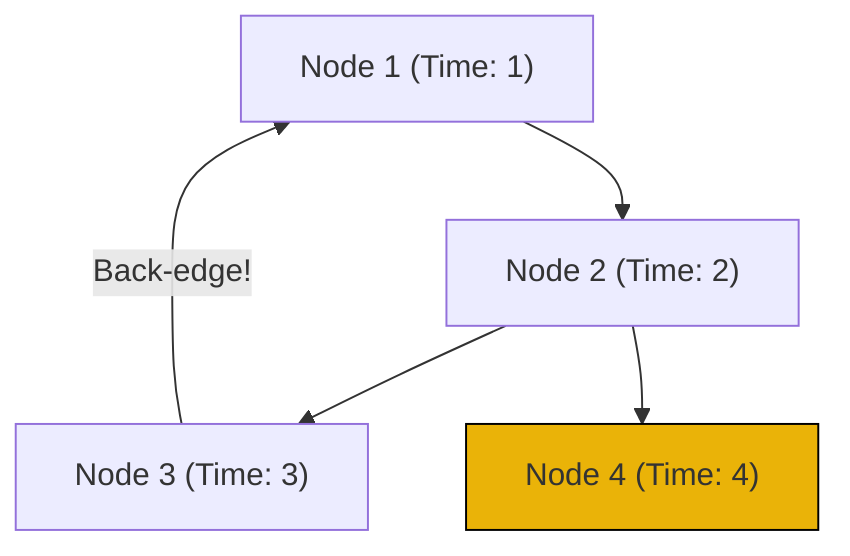

# Pattern 40: Articulation Points and Bridges

## 👶 Explain Like I'm 5

Imagine a group of islands connected by bridges.
If a bridge breaks, can people still travel between all the islands using
other longer routes?
A **Bridge** (or Critical Connection) is a connection that, if removed, splits the
islands into two completely disconnected groups!

An **Articulation Point** is similar, but for the islands themselves. If an island
sinks, and now the remaining islands are disconnected, that sunken island was an
Articulation Point.

---

## 🧩 Core Idea & Pattern Detection

To find these critical weak points, we use **Tarjan's Algorithm** (based on DFS).
As we do a DFS through the graph, we keep track of two numbers for every node:
1. `discovery_time`: The timestamp when we first visited this node (1st, 2nd, 3rd...).
2. `lowest_reachable_time`: The lowest timestamp we can reach from this node (or its children) *without going backward through the parent*.

### The Bridge Rule:
If we are at `Node A` and traveling to `Node B`:
After fully exploring `Node B`, if `Node B`'s `lowest_reachable_time` is STILL strictly
greater than `Node A`'s `discovery_time`, it means `Node B` found absolutely no back-alleys
to reach an earlier part of the graph.
Therefore, the edge `A-B` is the ONLY way in and out. It's a **Bridge**!

### When to use it:
- "Critical connections in a network"
- "Server networks where one cable fails"
- Keywords: "critical edge", "bridge", "disconnects the graph".

---

## 🔧 Visual Anatomy

Tarjan's DFS for finding a Bridge:

- Node 3 can reach Node 1, so its `lowest_time` becomes 1. Node 2 inherits this 1.
- Node 4 has no back-edges. Its `lowest_time` stays 4.
- Since Node 4's lowest time (4) > Node 2's discovery time (2), the edge `2-4` is a BRIDGE!

---

## ⏱️ Complexity Analysis

| Scenario | Time | Space |
|----------|------|-------|
| Tarjan's Algorithm | O(V + E) | O(V) for DFS stack and time arrays |

---

## ✅ Problems in This Pattern

| # | Problem | Difficulty | LeetCode |
|---|---------|------------|----------|
| 1 | Critical Connections in a Network | Hard | #1192 |
