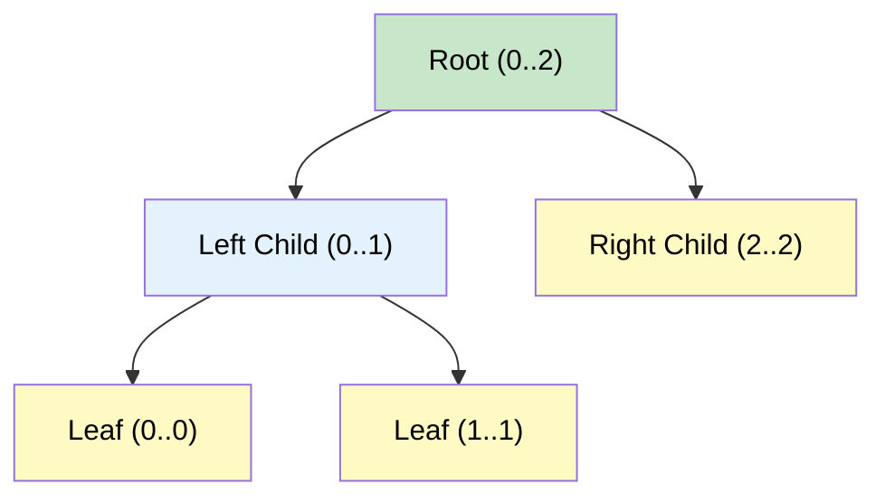

# 🚶‍♂️ Walkthrough: Range Sum Query - Mutable

## 👶 Explain Like I'm 5
You have a bunch of numbers. Your friend keeps asking you two types of questions:
1. "What is the sum of the numbers from index L to index R?"
2. "Can you change the number at index 3 to the number 15?"
If you use a Prefix Sum, finding the sum is super fast, but changing a number means you have to rewrite almost the whole Prefix Sum array!
Instead, we build a **Segment Tree**. Imagine a family tree, but going upwards. The bottom leaves are the individual numbers. A parent node is the sum of its two children. The grand-parent is the sum of its two parents. 
Now, if you change one leaf, you only have to update its parent, its grandparent, and so on up to the top! That's super fast! And to find the sum of a range, you just grab a few parents that perfectly cover that range.

## 🎯 Core Strategy
**Array-based Segment Tree**.

1. **Tree Array**: Create an array of size `4 * N` to hold our Segment Tree nodes. The left child of `node` is `2*node + 1`, right is `2*node + 2`.
2. **`_build`**: Recursively split the range `[start, end]` in half. When `start == end`, put `nums[start]` in the tree. Otherwise, build the left and right halves, and set `tree[node] = left_sum + right_sum`.
3. **`_update`**: Traverse down to the leaf for `index`. Update the leaf's value. As the recursion unwinds, update the parents with the new `left_sum + right_sum`.
4. **`_query`**:
   - If the node's range is *completely outside* `[L, R]`, return 0.
   - If the node's range is *completely inside* `[L, R]`, return `tree[node]`.
   - If it's *partially overlapping*, query both children and return their sum.

## 🏃‍♂️ Step-by-Step Execution (Dry Run)
**Input**: `nums = [1, 3, 5]`

**Build**:
- `_build(0..2)`: splits to `0..1` and `2..2`.
  - `_build(0..1)`: splits to `0..0` and `1..1`.
    - `0..0` leaf gets `1`.
    - `1..1` leaf gets `3`.
    - `0..1` parent gets `1 + 3 = 4`.
  - `2..2` leaf gets `5`.
  - `0..2` root gets `4 + 5 = 9`.

**Query `(0, 2)`**:
- The root node covers `0..2`. It perfectly matches `[0, 2]`. Return its value: **9**.

**Update `(1, 2)`**: (Change index 1 from 3 to 2).
- Start at root `0..2`. Index 1 is in left half `0..1`.
  - Go to `0..1`. Index 1 is in right half `1..1`.
    - Go to `1..1`. This is the leaf! Update value to `2`.
  - Back to `0..1`. Update value to `1 + 2 = 3`.
- Back to `0..2`. Update value to `3 + 5 = 8`.

**Query `(0, 2)`**:
- Root perfectly matches. Return **8**. ✅

## 📊 Visual Diagram

## 🛑 Complexity
- **Time:** $O(N)$ to build the tree. $O(\log N)$ for each query and update.
- **Space:** $O(N)$ for the `4 * N` sized tree array and recursion stack.
