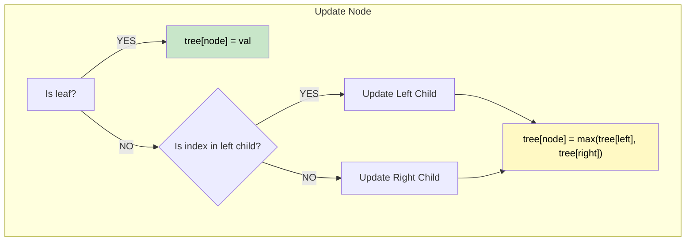

# 🚶‍♂️ Walkthrough: Range Maximum Query (Mutable)

## 👶 Explain Like I'm 5
This is exactly like the Range Sum Segment Tree, but instead of finding the *sum* of numbers, we want to find the *biggest* number!
Instead of a parent being the sum of its two children, the parent is the `max()` of its two children!
And when we ask a section of the tree for its max, if that section doesn't overlap with what we want at all, we return negative infinity (a super small number) so it never gets picked as the maximum!

## 🎯 Core Strategy
**Max-based Segment Tree**.

This is structurally identical to the Sum-based Segment Tree.
Differences:
1. **Build / Update**: `self.tree[node] = max(self.tree[left_node], self.tree[right_node])`
2. **Query (No Overlap)**: If the node's range `[start, end]` falls completely outside the query range `[L, R]`, return `float('-inf')` instead of `0`. This is because `0` might accidentally be larger than all negative numbers in our array!

## 🏃‍♂️ Step-by-Step Execution (Dry Run)
**Input**: `nums = [1, 8, 5, 9, 6, 3]`

**Build (Leaves)**:
Values: `[1]`, `[8]`, `[5]`, `[9]`, `[6]`, `[3]`

**Build (Parents)**:
- `max(1, 8) = 8`
- `max(5, 9) = 9`
- `max(6, 3) = 6`
- `max(8, 9) = 9`
- Root = `max(9, 6) = 9`.

**Query `(0, 2)`** (Range values: `[1, 8, 5]`):
- The tree traverses and finds the node covering `[0, 1]` (max is 8).
- It finds the node covering `[2, 2]` (max is 5).
- Returns `max(8, 5) = 8`.

**Update `(2, 15)`** (Change 5 to 15):
- The leaf at `[2, 2]` changes to 15.
- Its parent covering `[2, 3]` updates: `max(15, 9) = 15`.
- Its parent covering `[0, 3]` updates: `max(8, 15) = 15`.
- Root updates: `max(15, 6) = 15`.

**Query `(1, 4)`** (Range values: `[8, 15, 9, 6]`):
- Traverses the tree to get maxes for these subsets.
- Returns **15**. ✅

## 📊 Visual Diagram

## 🛑 Complexity
- **Time:** $O(N)$ build, $O(\log N)$ query/update.
- **Space:** $O(N)$ for the `4 * N` sized tree array.
