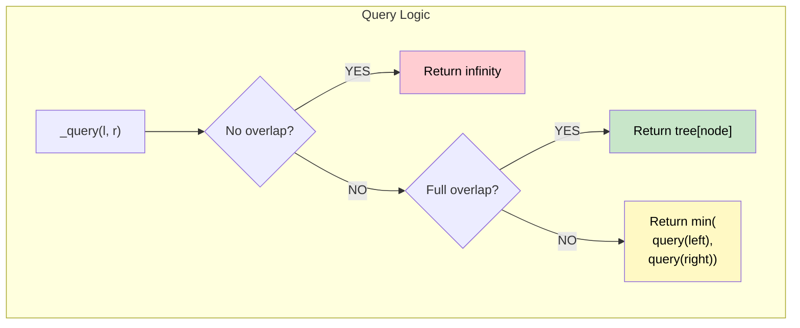

# 🚶‍♂️ Walkthrough: Range Minimum Query

## 👶 Explain Like I'm 5
This is exactly like the Range Sum and Range Max Segment Trees, but we want the *smallest* number!
Instead of a parent being the `sum` or `max` of its children, it is the `min()`!
And when we ask a section of the tree that we don't care about, we return `infinity` (a super big number) so it never gets picked as the minimum!

## 🎯 Core Strategy
**Min-based Segment Tree**.

Differences from Sum-based:
1. **Build / Update**: `self.tree[node] = min(self.tree[left_node], self.tree[right_node])`
2. **Query (No Overlap)**: If the node's range falls completely outside the query range `[L, R]`, return `float('inf')` instead of `0`.

## 🏃‍♂️ Step-by-Step Execution (Dry Run)
**Input**: `nums = [5, 2, 8, 1, 9, 3]`

**Build**:
- Leaves: 5, 2, 8, 1, 9, 3
- Parents: `min(5, 2) = 2`, `min(8, 1) = 1`, `min(9, 3) = 3`
- Grandparents: `min(2, 1) = 1`, `min(3, inf) = 3`
- Root: `min(1, 3) = 1`

**Query `(1, 4)`** (Values: `[2, 8, 1, 9]`):
- Tree finds `min` of these blocks.
- Returns **1**.

**Update `(3, 10)`** (Change 1 to 10):
- Leaf at index 3 becomes 10.
- Parent covering `[2, 3]` updates: `min(8, 10) = 8`.
- Grandparent covering `[0, 3]` updates: `min(2, 8) = 2`.
- Root updates: `min(2, 3) = 2`.

**Query `(1, 4)`** (Values: `[2, 8, 10, 9]`):
- Returns **2**. ✅

## 📊 Visual Diagram

## 🛑 Complexity
- **Time:** $O(N)$ build, $O(\log N)$ query/update.
- **Space:** $O(N)$ space for tree.
