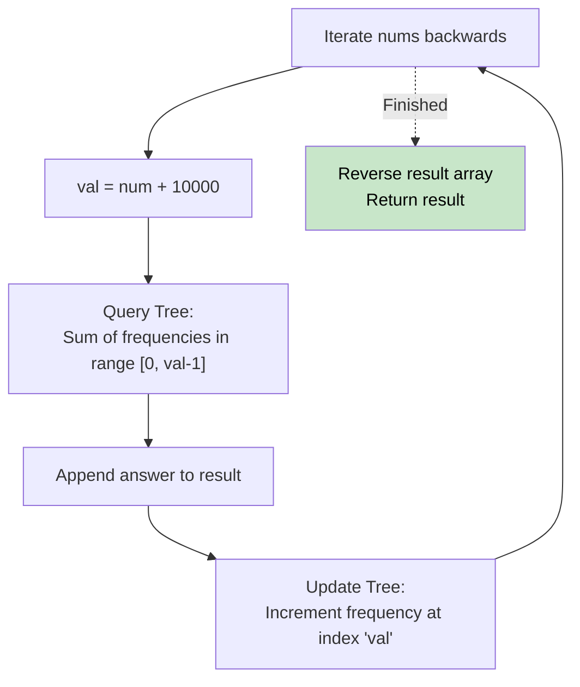

# 🚶‍♂️ Walkthrough: Count of Smaller Numbers After Self

## 👶 Explain Like I'm 5
You have a line of numbers. For every number, you want to know how many numbers to its RIGHT are smaller than it.
Instead of looping through the rest of the array every time, we can read the array BACKWARDS!
As we read numbers from right to left, we put them into a giant tally sheet (our Segment Tree) based on their *value*. 
When we look at the number `5`, we ask our tally sheet: "How many numbers have you seen so far that are between the values 0 and 4?" The tally sheet tells us instantly! Then we add a tally mark for the number `5`.

## 🎯 Core Strategy
**Frequency Segment Tree**.

Instead of a Segment Tree tracking sums of *indices* in the original array, the tree represents the **possible values** in the array! `tree[node]` holds the *count* (frequency) of how many times values in this range have been seen.
1. **Value Mapping**: Values can be negative (`-10000` to `10000`). To use them as array indices, apply an offset: `val = num + 10000`. Now values are `0` to `20000`. The tree size is 20002.
2. **Iterate Backwards**: Traverse `nums` from right to left.
3. **Query**: For the current `val`, query the Segment Tree for the sum in the range `[0, val - 1]`. This is exactly how many smaller numbers have been processed so far (which were to the right of `val` in the original array).
4. **Update**: Add `val` to the Segment Tree (increment its frequency by 1).
5. **Reverse Result**: Since we iterated backwards, reverse the `result` list before returning.

## 🏃‍♂️ Step-by-Step Execution (Dry Run)
**Input**: `nums = [5, 2, 6, 1]` (Offset: none needed for positive dry run).

Read backwards:
- **Num = 1**:
  - Query sum in `[0, 0]`. Tree is empty. Result = **0**.
  - Update tree: frequency of `1` becomes 1.
- **Num = 6**:
  - Query sum in `[0, 5]`. Tree has `1` at value 1. Result = **1**.
  - Update tree: frequency of `6` becomes 1.
- **Num = 2**:
  - Query sum in `[0, 1]`. Tree has `1` at value 1. Result = **1**.
  - Update tree: frequency of `2` becomes 1.
- **Num = 5**:
  - Query sum in `[0, 4]`. Tree has 1 at value 1, and 1 at value 2. Result = **2**.
  - Update tree: frequency of `5` becomes 1.

Result List: `[0, 1, 1, 2]`.
Reverse it: `[2, 1, 1, 0]`. ✅

## 📊 Visual Diagram

## 🛑 Complexity
- **Time:** $O(N \log M)$ where $N$ is length of array and $M$ is the range of possible values (20,000). Query and update take $O(\log M)$ time.
- **Space:** $O(M)$ for the Segment Tree array (size $4 \times 20000$).
