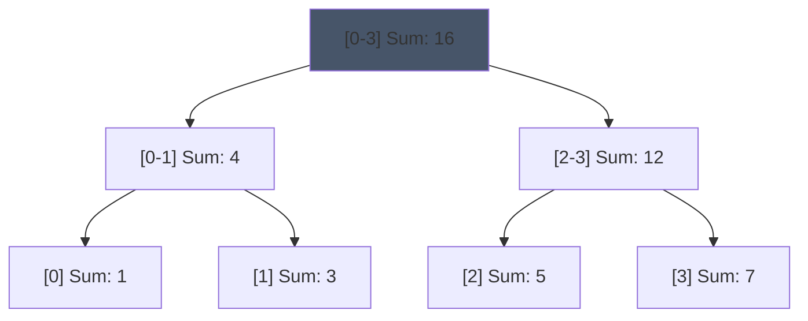
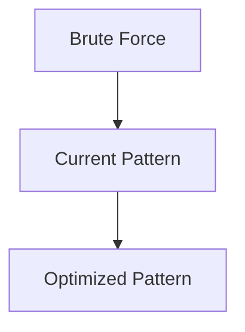

# Pattern 41: Segment Tree

## 👶 Explain Like I'm 5

Imagine you have a long row of 8 piggy banks.
Someone keeps asking you two things:
1. "How much money is in banks 2 through 6?"
2. "I just put $5 into bank 4, update the total!"

If you use a Prefix Sum, answering #1 is fast, but updating #2 requires changing all the
prefix sums after bank 4! (Slow).
If you just use a normal array, updating #2 is fast, but answering #1 requires adding
up all the banks one by one! (Slow).

A **Segment Tree** builds a tree above the piggy banks.
The bottom leaves are the individual banks.
Their parents are the sum of two banks.
Their parents are the sum of four banks, etc.
Now, you can both UPDATE a bank and QUERY a range very fast!

---

## 🧩 Core Idea & Pattern Detection

A Segment Tree is a Binary Tree where each node represents an **interval** (or segment)
of the array. The root represents the whole array `[0, N-1]`.
Its left child represents `[0, mid]`, and right child `[mid+1, N-1]`.

### The Three Operations:
1. **Build**: Recursively build the tree from the array. `O(N)`
2. **Update**: Go down to the specific leaf, update it, and as you return up the recursion stack, update the parents. `O(log N)`
3. **Query**: If the current node's interval is COMPLETELY inside the query interval, return its value. If it's completely OUTSIDE, return 0. If it PARTIALLY overlaps, ask both children and sum their answers! `O(log N)`

### When to use it:
- We need to answer **Range Queries** (Sum, Min, Max, GCD) AND **Point Updates**.
- Keywords: "mutable", "update element", "sum of range".

---

## 🔧 Visual Anatomy

Segment Tree for `[1, 3, 5, 7]` (Sum Query):



---

## ⏱️ Complexity Analysis

| Operation | Time | Space |
|----------|------|-------|
| Build | O(N) | O(N) (specifically 4N size array) |
| Update | O(log N) | O(log N) call stack |
| Query | O(log N) | O(log N) call stack |

---

## ✅ Problems in This Pattern

| # | Problem | Difficulty | LeetCode |
|---|---------|------------|----------|
| 1 | Range Sum Query - Mutable | Medium | #307 |
| 2 | Range Maximum Query (Mutable) | Medium | Classic CP |


## 📦 Prerequisite Data Structures
- Basic understanding of Arrays, Hash Maps, and Segment Tree fundamentals.


## 🔍 How to Spot This Pattern (Signal Detection)
- **Keywords**: "minimize", "maximize", "combinations", "shortest", "longest".
- **Problem Constraints**: Indicates whether O(N), O(N log N), or O(2^N) is acceptable.


## 🔧 Algorithmic Anatomy
### Variable Table
| Variable | Purpose |
|---|---|
| `result` | Stores the final answer |
| `visited` | Tracks seen elements to avoid cycles or re-processing |

### Step-by-Step Recipe
1. Initialize data structures.
2. Iterate through the input.
3. Update state based on current element.
4. Return result.

### Loop Invariants
- At the start of each iteration, the state reflects the optimal solution up to the previous element.

### DOs and DON'Ts
- **DO**: Trace through an example manually before coding.
- **DON'T**: Forget edge cases like empty inputs.


## 🏗️ Template / Boilerplate Code
```python
def solve_segment_tree(nums):
    # Initialize state
    result = 0
    for num in nums:
        # Process num
        pass
    return result
```


## 🔄 Brute Force → Optimal Evolution
- **Brute Force**: Try all possibilities (often O(N^2) or O(2^N)).
- **Optimal**: Use this pattern to reduce redundant work to O(N) or O(N log N).


## 🔗 Pattern Connections



## ⚠️ Common Mistakes & Pitfalls
- Off-by-one errors in loop boundaries.
- Not handling negative numbers or zero correctly.
- Forgetting to update the result variable inside the loop.


## 🎤 Interview Communication Guide
1. **Acknowledge**: "This looks like a variation of the classic problem..."
2. **Propose**: "I'll use this pattern because it optimizes the brute force O(N^2) to O(N)."
3. **Execute**: Write clean, modular code.
4. **Review**: Trace with the provided edge case.


## 🧪 Self-Test Questions
<details>
<summary>When should you use this pattern?</summary>
When the problem asks for optimal subarrays, combinations, or specific mathematical properties.
</details>
<details>
<summary>What is the typical time complexity?</summary>
Usually O(N) or O(N log N), depending on sorting or data structure overhead.
</details>
