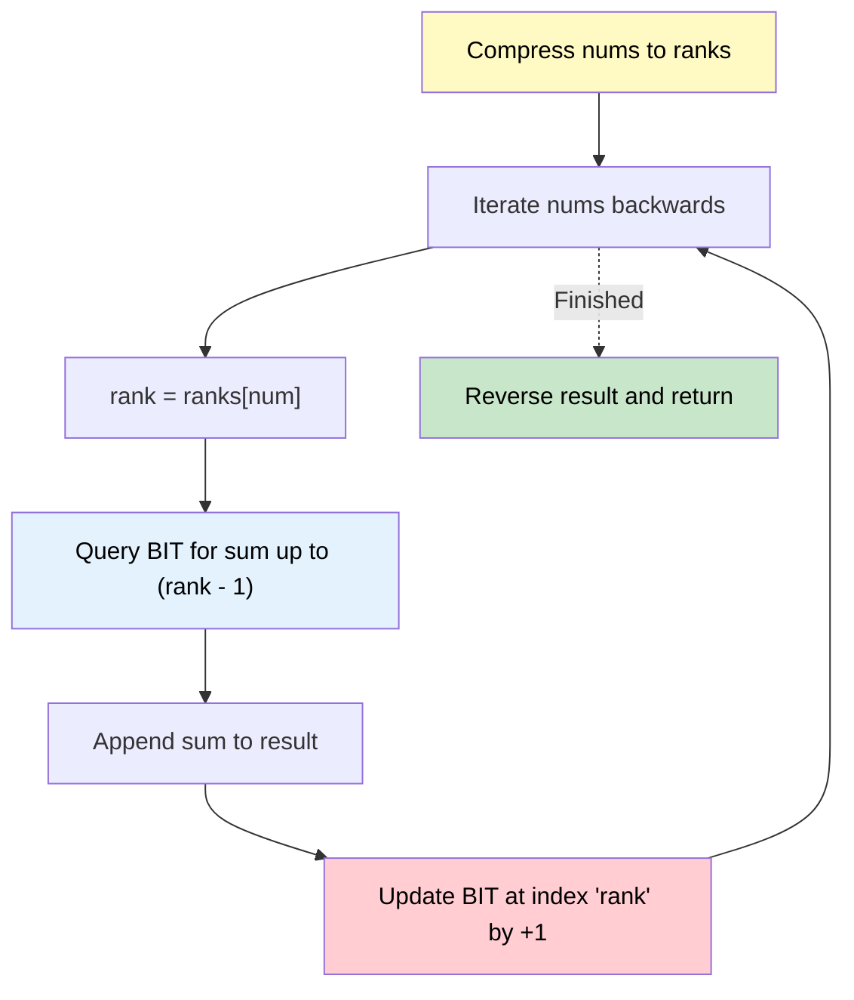

# 🚶‍♂️ Walkthrough: Count of Smaller Numbers After Self (BIT Version)

## 👶 Explain Like I'm 5
You have a line of numbers. For every number, you want to know how many numbers to its RIGHT are smaller than it.
We solved this with a Segment Tree, but a Binary Indexed Tree (BIT) is much cleaner!
Because the numbers can be very large (like 10,000) or negative (like -10,000), we don't want a BIT that is 20,000 elements long. Instead, we "compress" the numbers into rankings. 
If our numbers are `[5, 2, 6, 1]`, the sorted unique numbers are `[1, 2, 5, 6]`. We give them ranks: `1->1, 2->2, 5->3, 6->4`.
Now, we read the array backward. When we see `5` (rank 3), we ask the BIT: "How many numbers have rank 1 or 2?" The BIT answers! Then we add rank 3 to the BIT and move on!

## 🎯 Core Strategy
**Binary Indexed Tree + Coordinate Compression**.

1. **Coordinate Compression**: Find all unique values in the array, sort them, and map them to a 1-indexed rank. (e.g., smallest number gets rank 1, next gets rank 2). This ensures our BIT only needs to be as large as the number of unique elements!
2. **BIT setup**: The BIT will store frequencies. `tree[rank]` will store how many times we've seen a number with that rank.
3. **Iterate Right to Left**:
   - For a number, find its `rank = ranks[num]`.
   - We want the count of all strictly smaller numbers we've seen so far. We query the BIT for the prefix sum up to `rank - 1`.
   - We append this count to our result array.
   - We then update the BIT by adding 1 to the frequency at `rank`.
4. **Reverse**: Since we built the result array by iterating right to left, reverse the result array before returning.

## 🏃‍♂️ Step-by-Step Execution (Dry Run)
**Input**: `nums = [5, 2, 6, 1]`

**Compression**:
- Unique sorted: `[1, 2, 5, 6]`
- Ranks: `{1: 1, 2: 2, 5: 3, 6: 4}`
- BIT size = 4. `tree = [0, 0, 0, 0, 0]`

**Iterate Right to Left**:
1. **Num = 1**:
   - Rank = `ranks[1] = 1`.
   - Query(`rank - 1` = 0) -> Returns 0. `result = [0]`
   - Update(`rank` = 1, delta = 1).
2. **Num = 6**:
   - Rank = `ranks[6] = 4`.
   - Query(`rank - 1` = 3) -> Returns sum of ranks 1..3. Rank 1 has frequency 1. Returns 1. `result = [0, 1]`
   - Update(`rank` = 4, delta = 1).
3. **Num = 2**:
   - Rank = `ranks[2] = 2`.
   - Query(`rank - 1` = 1) -> Returns sum of rank 1. Rank 1 has frequency 1. Returns 1. `result = [0, 1, 1]`
   - Update(`rank` = 2, delta = 1).
4. **Num = 5**:
   - Rank = `ranks[5] = 3`.
   - Query(`rank - 1` = 2) -> Returns sum of ranks 1..2. Rank 1 has freq 1, Rank 2 has freq 1. Returns 2. `result = [0, 1, 1, 2]`
   - Update(`rank` = 3, delta = 1).

**Final Step**: Reverse `result` -> `[2, 1, 1, 0]`. ✅

## 📊 Visual Diagram

## 🛑 Complexity
- **Time:** $O(N \log N)$ to sort for compression, and $O(N \log N)$ for processing the BIT. Overall $O(N \log N)$.
- **Space:** $O(N)$ for the ranks hash map, the BIT array, and the result array.
