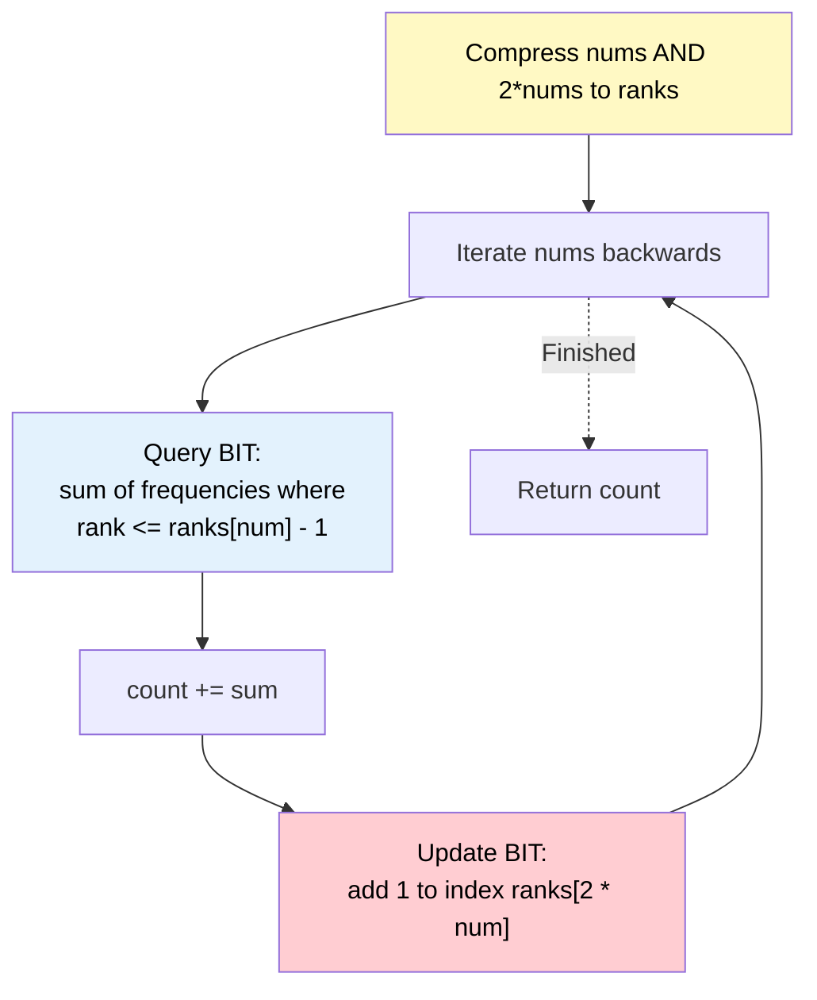

# 🚶‍♂️ Walkthrough: Reverse Pairs

## 👶 Explain Like I'm 5
We need to find pairs of numbers where the number on the left is MORE THAN DOUBLE the number on the right.
This is exactly like the "Count Smaller Numbers After Self" problem, but instead of finding numbers that are smaller, we find numbers whose *double* is smaller!
We read the array backwards. 
For a number `X`, we want to know how many times we previously saw a number `Y` where `2 * Y < X`.
To do this efficiently, we use a Binary Indexed Tree. We compress all the numbers AND their doubled values into ranks.
When we see `X`, we ask the BIT: "How many numbers have a rank strictly less than the rank of `X`?" (Because we put `2 * Y` into the BIT!). Then, we add `2 * X` into the BIT so future numbers can compare against it!

## 🎯 Core Strategy
**BIT + Coordinate Compression (Value and Doubled Value)**.

1. **Coordinate Compression**: Collect both `num` AND `2 * num` for every element in the array. Sort these unique values and map them to ranks (1 to $K$).
2. **Iterate Right to Left**:
   - For the current number `num`: We want to count how many elements `j` to the right satisfy `num > 2 * nums[j]`.
   - Because we will insert `2 * nums[j]` into the BIT, the condition `num > 2 * nums[j]` translates to querying the BIT for the prefix sum of frequencies for all ranks strictly less than the rank of `num`.
   - `count += bit.query( ranks[num] - 1 )`.
   - Finally, insert `2 * num` into the BIT for future comparisons to the left. `bit.update( ranks[2 * num], 1 )`.

## 🏃‍♂️ Step-by-Step Execution (Dry Run)
**Input**: `nums = [2, 4, 3, 5, 1]`

**Compression**:
- Values: `(2,4), (4,8), (3,6), (5,10), (1,2)` -> Set: `{1,2,3,4,5,6,8,10}`
- Ranks: `{1:1, 2:2, 3:3, 4:4, 5:5, 6:6, 8:7, 10:8}`
- BIT Size: 8.

**Iterate Right to Left**:
1. **num = 1**:
   - Query: `< ranks[1]` -> `< 1` -> query(0) = 0.
   - Update: add 1 to `ranks[2 * 1]` -> `ranks[2]` -> index 2.
2. **num = 5**:
   - Query: `< ranks[5]` -> `< 5` -> query(4). BIT has a 1 at index 2 (from `2*1`). Sum = 1. (`count` = 1)
   - Update: add 1 to `ranks[2 * 5]` -> `ranks[10]` -> index 8.
3. **num = 3**:
   - Query: `< ranks[3]` -> `< 3` -> query(2). BIT has a 1 at index 2. Sum = 1. (`count` = 1 + 1 = 2)
   - Update: add 1 to `ranks[2 * 3]` -> `ranks[6]` -> index 6.
4. **num = 4**:
   - Query: `< ranks[4]` -> `< 4` -> query(3). BIT has a 1 at index 2. Sum = 1. (`count` = 2 + 1 = 3)
   - Update: add 1 to `ranks[2 * 4]` -> `ranks[8]` -> index 7.
5. **num = 2**:
   - Query: `< ranks[2]` -> `< 2` -> query(1). BIT has nothing below index 2. Sum = 0.
   - Update: add 1 to `ranks[2 * 2]` -> `ranks[4]` -> index 4.

Result: `count` = **3**. ✅ (The pairs are (4,1), (3,1), and (5,1)).

## 📊 Visual Diagram

## 🛑 Complexity
- **Time:** $O(N \log N)$ to sort for coordinate compression, and $O(N \log N)$ to process the BIT queries and updates.
- **Space:** $O(N)$ for the unique values set, rank mapping, and the BIT array.
