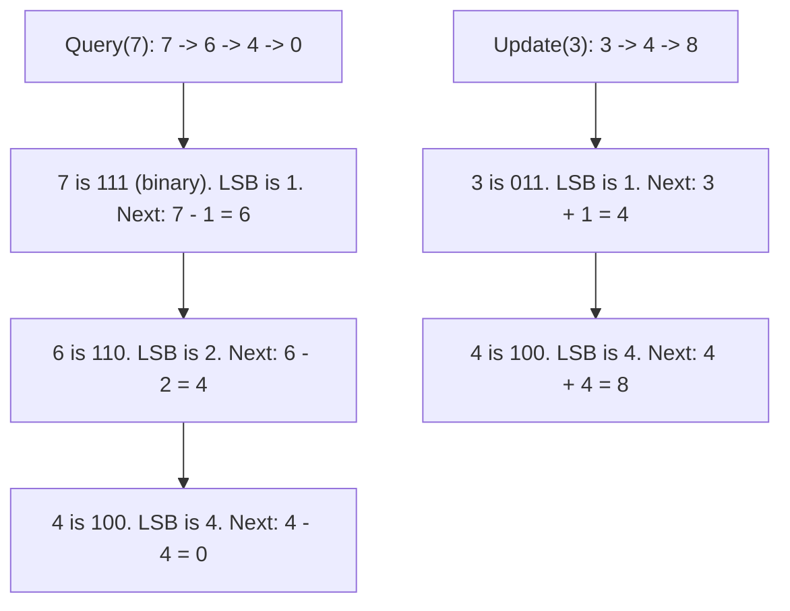
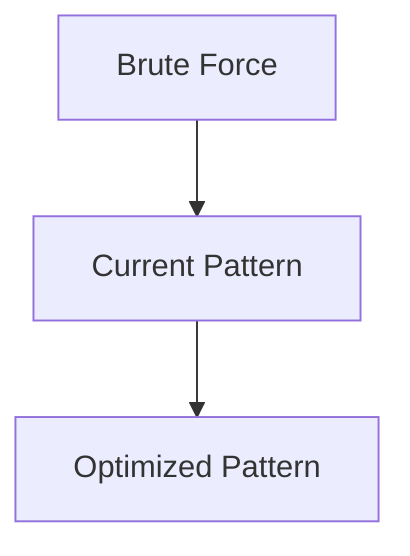

# Pattern 42: Binary Indexed Tree (Fenwick Tree)

## 👶 Explain Like I'm 5

Remember the Segment Tree? It's powerful, but it takes up `4 * N` space and is
complicated to write.
A **Binary Indexed Tree (BIT)** or Fenwick Tree is a super clever hack.
It uses a normal array of size `N + 1`, and uses **Binary Numbers** to know which
elements to add up!

When you want to know the sum of the first 13 elements, 13 in binary is `1101`
(which is `8 + 4 + 1`).
The BIT just adds the chunk for 8, the chunk for 4, and the chunk for 1.
It's pure magic that takes almost no code to write!

---

## 🧩 Core Idea & Pattern Detection

The BIT is used for **Prefix Sums with Updates**.
- `query(i)`: Returns the sum from index 1 to `i`.
- `update(i, delta)`: Adds `delta` to index `i`.

### The Magic Formula: `i & (-i)`
This bitwise operation extracts the **Least Significant Bit (LSB)** of a number.
- To **query**: You go backwards. `i = i - (i & -i)`. This jumps to the next chunk you need to add.
- To **update**: You go forwards. `i = i + (i & -i)`. This jumps to all the "parent" chunks that contain this index, so you can update them!

### When to use it:
- Finding inversions in an array (e.g., Count of Smaller Numbers After Self).
- Range Sum Queries with Mutable arrays.
- Keywords: "mutable", "count smaller elements to the right".

---

## 🔧 Visual Anatomy

Jumping with the LSB (Update vs Query):



---

## ⏱️ Complexity Analysis

| Operation | Time | Space |
|----------|------|-------|
| Build | O(N log N) | O(N) |
| Update | O(log N) | O(1) extra space |
| Query | O(log N) | O(1) extra space |

Notice the space is strictly `O(N)`, unlike Segment Tree which is `O(4N)`.

---

## ✅ Problems in This Pattern

| # | Problem | Difficulty | LeetCode |
|---|---------|------------|----------|
| 1 | Range Sum Query Mutable (BIT Version) | Medium | #307 |
| 2 | Count of Smaller Numbers After Self | Hard | #315 |


## 📦 Prerequisite Data Structures
- Basic understanding of Arrays, Hash Maps, and Binary Indexed Tree fundamentals.


## 🔍 How to Spot This Pattern (Signal Detection)
- **Keywords**: "minimize", "maximize", "combinations", "shortest", "longest".
- **Problem Constraints**: Indicates whether O(N), O(N log N), or O(2^N) is acceptable.


## 🔧 Algorithmic Anatomy
### Variable Table
| Variable | Purpose |
|---|---|
| `result` | Stores the final answer |
| `visited` | Tracks seen elements to avoid cycles or re-processing |

### Step-by-Step Recipe
1. Initialize data structures.
2. Iterate through the input.
3. Update state based on current element.
4. Return result.

### Loop Invariants
- At the start of each iteration, the state reflects the optimal solution up to the previous element.

### DOs and DON'Ts
- **DO**: Trace through an example manually before coding.
- **DON'T**: Forget edge cases like empty inputs.


## 🏗️ Template / Boilerplate Code
```python
def solve_binary_indexed_tree(nums):
    # Initialize state
    result = 0
    for num in nums:
        # Process num
        pass
    return result
```


## 🔄 Brute Force → Optimal Evolution
- **Brute Force**: Try all possibilities (often O(N^2) or O(2^N)).
- **Optimal**: Use this pattern to reduce redundant work to O(N) or O(N log N).


## 🔗 Pattern Connections



## ⚠️ Common Mistakes & Pitfalls
- Off-by-one errors in loop boundaries.
- Not handling negative numbers or zero correctly.
- Forgetting to update the result variable inside the loop.


## 🎤 Interview Communication Guide
1. **Acknowledge**: "This looks like a variation of the classic problem..."
2. **Propose**: "I'll use this pattern because it optimizes the brute force O(N^2) to O(N)."
3. **Execute**: Write clean, modular code.
4. **Review**: Trace with the provided edge case.


## 🧪 Self-Test Questions
<details>
<summary>When should you use this pattern?</summary>
When the problem asks for optimal subarrays, combinations, or specific mathematical properties.
</details>
<details>
<summary>What is the typical time complexity?</summary>
Usually O(N) or O(N log N), depending on sorting or data structure overhead.
</details>
