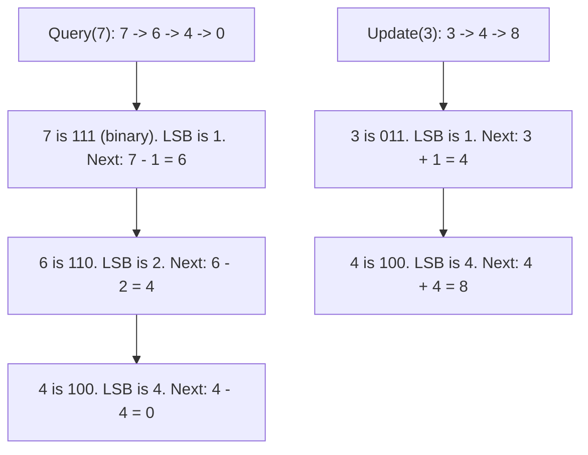

# Pattern 42: Binary Indexed Tree (Fenwick Tree)

## 👶 Explain Like I'm 5

Remember the Segment Tree? It's powerful, but it takes up `4 * N` space and is
complicated to write.
A **Binary Indexed Tree (BIT)** or Fenwick Tree is a super clever hack.
It uses a normal array of size `N + 1`, and uses **Binary Numbers** to know which
elements to add up!

When you want to know the sum of the first 13 elements, 13 in binary is `1101`
(which is `8 + 4 + 1`).
The BIT just adds the chunk for 8, the chunk for 4, and the chunk for 1.
It's pure magic that takes almost no code to write!

---

## 🧩 Core Idea & Pattern Detection

The BIT is used for **Prefix Sums with Updates**.
- `query(i)`: Returns the sum from index 1 to `i`.
- `update(i, delta)`: Adds `delta` to index `i`.

### The Magic Formula: `i & (-i)`
This bitwise operation extracts the **Least Significant Bit (LSB)** of a number.
- To **query**: You go backwards. `i = i - (i & -i)`. This jumps to the next chunk you need to add.
- To **update**: You go forwards. `i = i + (i & -i)`. This jumps to all the "parent" chunks that contain this index, so you can update them!

### When to use it:
- Finding inversions in an array (e.g., Count of Smaller Numbers After Self).
- Range Sum Queries with Mutable arrays.
- Keywords: "mutable", "count smaller elements to the right".

---

## 🔧 Visual Anatomy

Jumping with the LSB (Update vs Query):

---

## ⏱️ Complexity Analysis

| Operation | Time | Space |
|----------|------|-------|
| Build | O(N log N) | O(N) |
| Update | O(log N) | O(1) extra space |
| Query | O(log N) | O(1) extra space |

Notice the space is strictly `O(N)`, unlike Segment Tree which is `O(4N)`.

---

## ✅ Problems in This Pattern

| # | Problem | Difficulty | LeetCode |
|---|---------|------------|----------|
| 1 | Range Sum Query Mutable (BIT Version) | Medium | #307 |
| 2 | Count of Smaller Numbers After Self | Hard | #315 |
