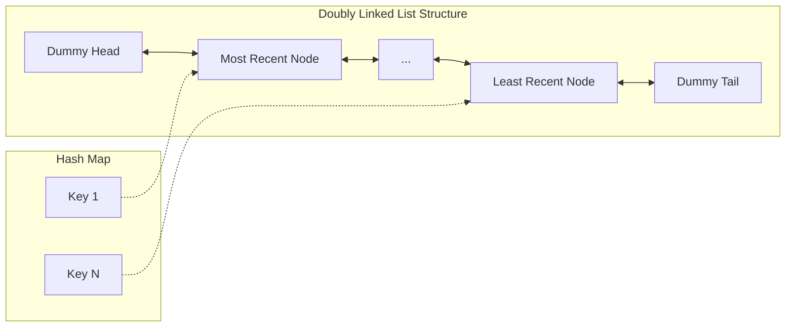

# 🚶‍♂️ Walkthrough: LRU Cache

## 👶 Explain Like I'm 5
Imagine you have a bookshelf that only holds 3 books. You keep reading different books. 
Whenever you read a book, you put it on the *very left* of the shelf (because it's your favorite right now).
If you want to read a 4th book, there is no space! So, you throw away the book on the *very right* of the shelf, because that's the one you haven't touched in the longest time.
This is exactly how an LRU (Least Recently Used) cache works. The "very left" is the Head, and the "very right" is the Tail. 
To do this instantly without moving every book one-by-one, we link the books together with string (a Doubly Linked List) and keep a cheat-sheet of exactly where every book is (a Hash Map).

## 🎯 Core Strategy
**Hash Map + Doubly Linked List**.

1. **Doubly Linked List (DLL)**: Creates an order of items based on when they were last accessed.
   - We use a Dummy Head and Dummy Tail.
   - The node directly after the Head is the Most Recently Used.
   - The node directly before the Tail is the Least Recently Used.
   - Moving a node to the front means disconnecting it from its current neighbors, and inserting it between Head and Head's previous next node.
2. **Hash Map**: Maps the `key` to the actual `Node` object. This allows us to find any node in the DLL in $O(1)$ time without having to traverse the list!
3. **`get(key)`**: If key is in Map, grab the Node. Extract it from the DLL, insert it right after the Head. Return value.
4. **`put(key, val)`**: 
   - If key exists, grab it, update value, extract it, insert after Head.
   - If new, create Node, insert after Head, put in Map.
   - If capacity is exceeded, grab the node before Tail. Delete it from DLL, delete its key from Map.

## 🏃‍♂️ Step-by-Step Execution (Dry Run)
**Capacity**: 2.
Init: `[Head] <-> [Tail]`

**put(1, 1)**:
- New node: `{key:1, val:1}`
- Insert after Head: `[Head] <-> [1] <-> [Tail]`
- Map: `{1: Node(1)}`

**put(2, 2)**:
- New node: `{key:2, val:2}`
- Insert after Head: `[Head] <-> [2] <-> [1] <-> [Tail]`
- Map: `{1: Node(1), 2: Node(2)}`

**get(1)**:
- Found in Map. Remove `[1]`, insert after Head.
- `[Head] <-> [1] <-> [2] <-> [Tail]` (1 is now Most Recently Used!).
- Return 1.

**put(3, 3)**:
- New node: `{key:3, val:3}`
- Insert after Head: `[Head] <-> [3] <-> [1] <-> [2] <-> [Tail]`
- Map: `{1: Node(1), 2: Node(2), 3: Node(3)}`
- Over capacity! Delete LRU (node before Tail, which is 2).
- Remove `[2]`. Map deletes key 2.
- `[Head] <-> [3] <-> [1] <-> [Tail]`

## 📊 Visual Diagram

## 🛑 Complexity
- **Time:** $O(1)$ for both `get` and `put`. Hash Map gives instant access, and DLL allows instant removal/insertion.
- **Space:** $O(\text{capacity})$ for the Hash Map and the nodes in the Linked List.
