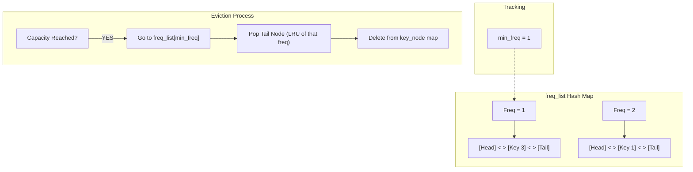

# 🚶‍♂️ Walkthrough: LFU Cache

## 👶 Explain Like I'm 5
Imagine a bookshelf where you can only hold 3 books. 
Instead of sorting them by *when* you last read them, you sort them by *how many times* you've read them!
If your shelf is full, you throw away the book you've read the least.
What if there's a tie? What if there are two books you've only read 1 time? Then, you throw away the one you haven't read in the longest time (like LRU).
To do this super fast, we have multiple shelves! Shelf 1 holds all books read 1 time. Shelf 2 holds books read 2 times.
Every shelf is its own LRU queue! We just keep track of which shelf has the lowest number (e.g., Shelf 1). If we need space, we go to that minimum shelf and throw away the book at the very end of it!

## 🎯 Core Strategy
**Two Hash Maps (Key->Node and Freq->DLL) + Min Freq Pointer**.

1. **`key_node` Map**: Maps `key` to `Node(key, val, freq)`. Standard $O(1)$ lookup.
2. **`freq_list` Map**: Maps `frequency` (int) to a `DoublyLinkedList`. This means ALL items with a frequency of `5` are kept in their own LRU queue!
3. **`min_freq`**: An integer tracking the lowest frequency currently in the cache. 
4. **Updating Frequency**: When an item is accessed (via `get` or `put`):
   - Remove it from its current DLL in `freq_list[node.freq]`.
   - If that DLL becomes empty AND `node.freq == min_freq`, we must increment `min_freq += 1`!
   - Increment `node.freq += 1`.
   - Add it to the new DLL: `freq_list[node.freq]`.
5. **Eviction**: If capacity is reached during a new `put`:
   - Go to `freq_list[min_freq]`.
   - Pop the tail (the LRU item for this lowest frequency).
   - Delete it from `key_node`.

## 🏃‍♂️ Step-by-Step Execution (Dry Run)
**Capacity**: 2.
Init: `min_freq = 0`. Maps empty.

**put(1, 1)**:
- New node: `{key:1, freq:1}`.
- `freq_list[1]` gets Node 1. `key_node` gets Node 1.
- `min_freq = 1`.

**put(2, 2)**:
- New node: `{key:2, freq:1}`.
- `freq_list[1]` gets Node 2. (List 1 is now `[Head] <-> [2] <-> [1] <-> [Tail]`).
- `min_freq = 1`.

**get(1)**:
- Find Node 1. Remove from `freq_list[1]`.
- (min_freq is 1, but list 1 is not empty, it still has Node 2. min_freq stays 1).
- Node 1 freq becomes 2. Add to `freq_list[2]`.

**put(3, 3)**:
- Cache is full (2 items). Must evict!
- Lowest freq is `min_freq = 1`.
- `freq_list[1]` has `[2]`. Pop LRU tail -> Node 2! Delete key 2.
- New node: `{key:3, freq:1}`.
- Add to `freq_list[1]`. `min_freq = 1`.

## 📊 Visual Diagram

## 🛑 Complexity
- **Time:** $O(1)$ for all operations. Moving nodes between DLLs is $O(1)$.
- **Space:** $O(\text{capacity})$ for the Hash Maps and nodes.
