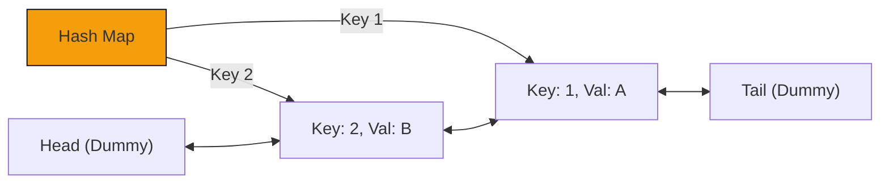

# Pattern 43: Miscellaneous

## 👶 Explain Like I'm 5

Sometimes in coding interviews, you get problems that are just famous "System Design"
or "Data Structure Design" questions that don't neatly fit into a single algorithmic
pattern like Two Pointers or Sliding Window.
They are beautiful mashups of Hash Maps, Doubly Linked Lists, and Heaps.

The most famous of these are Caches.
A **Cache** is like a fast mini-fridge next to your desk. You can only fit a few
things in it. When it gets full, you have to throw something out to make room for
a new item. But WHAT do you throw out?
- **LRU (Least Recently Used)**: Throw out the thing you haven't touched in the longest time.
- **LFU (Least Frequently Used)**: Throw out the thing you've eaten the least amount of times.

---

## 🧩 Core Idea & Pattern Detection

### 1. LRU Cache
Requires `O(1)` time for `get` and `put`.
- **Data Structure**: Hash Map + Doubly Linked List.
- **Hash Map**: Maps `key` -> `Node in Linked List`. Gives O(1) access.
- **Doubly Linked List**: Keeps track of time. Most recently used goes to the Head. Least recently used falls to the Tail.

### 2. LFU Cache
Requires `O(1)` time for `get` and `put`.
- **Data Structure**: Two Hash Maps + Multiple Doubly Linked Lists.
- **Map 1**: `key` -> `Node`.
- **Map 2**: `frequency` -> `Doubly Linked List of Nodes with that frequency`.
- **MinFreq variable**: Keeps track of the lowest frequency currently in the cache so we know which list to pop from when full.

### When to use it:
- Design a Cache.
- The problem asks for O(1) insert, delete, and random access.

---

## 🔧 Visual Anatomy

LRU Cache (Hash Map + DLL):

*Node 2 was just used, so it was moved right next to the Head! Node 1 is falling towards the Tail.*

---

## ⏱️ Complexity Analysis

| Cache Type | Time per operation | Space |
|------------|--------------------|-------|
| LRU Cache | O(1) | O(Capacity) |
| LFU Cache | O(1) | O(Capacity) |

---

## ✅ Problems in This Pattern

| # | Problem | Difficulty | LeetCode |
|---|---------|------------|----------|
| 1 | LRU Cache | Medium | #146 |
| 2 | LFU Cache | Hard | #460 |
