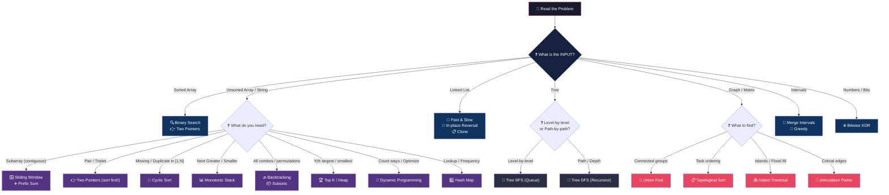
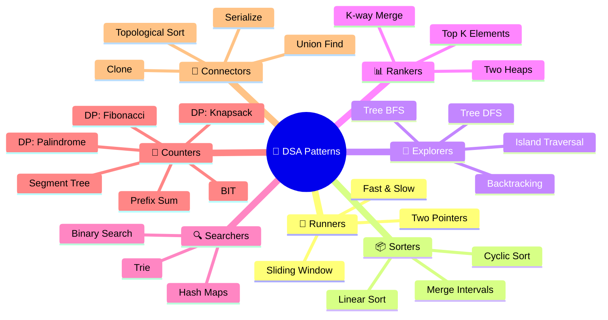

# 🧠 Data Structures & Algorithms — The Complete Pattern Bible

[](https://vadde.github.io/DSA/)
[](https://github.com/vadde/DSA/actions)

> 🚀 **Explore the Interactive Living Documentation Portal**: **[https://vadde.github.io/DSA/](https://vadde.github.io/DSA/)**  
> Complete interactive architecture with 44 patterns, 14 engines, 460 isolated visual diagrams, full-text Cmd+K search, SIFT simulator, and multi-theme cosmic liquid-glass UI.

> *"You don't need to memorize 43 patterns. You need to memorize **5 questions**, **7 families**, and **1 mantra**."*

---

## 🏛️ The Three Pillars of Mastery

```
┌───────────────────────────────────────────────────────────────────────────────┐
│ 🏛️ PILLAR 0: THEORETICAL FOUNDATIONS (The Physics of Computation)             │
│ Computability (Turing/Rice) • Complexity Zoo (P, NP, PSPACE) • Lower Bounds   │
│ Asymptotics • Amortization • Approximations • Heuristics • Engineering Triage │
│ 📂 00 - Fundamentals/000 - Theoretical Foundations (The Complete Guide)/      │
└───────────────────────────────────────┬───────────────────────────────────────┘
                                       ▼
┌──────────────────────────────────────────────────────────────────────────────┐
│ ⚙️ PILLAR 1: DATA STRUCTURE ENGINE ROOMS (The Concrete Mechanics)             │
│ Stacks • Queues • Linked Lists • Heaps • BSTs • Tries • Trees • Graphs       │
│ 📂 00 - Fundamentals/ (001 - 014 Engines, 015 Trees Guide, 016 Graphs Guide) │
└──────────────────────────────────────┬───────────────────────────────────────┘
                                       ▼
┌─────────────────────────────────────────────────────────────────────────────┐
│ ⚔️ PILLAR 2: ALGORITHMIC PATTERNS (The Tactical Arsenal)                     │
│ 43 Patterns • SIFT Method • 7 Pattern Families • Muscle Memory Skeletons    │
│ 📂 01 - Warmup/ ... 43 - Miscellaneous/                                     │
└─────────────────────────────────────────────────────────────────────────────┘
```

---

## 🔑 The SIFT Method — Your 10-Second Pattern Finder

Before writing a single line of code, say this out loud:

> ***"My input is a ____. I need to find ____. The constraint is ____. Therefore, the pattern is ____."***

- **S**tate the problem in your own words
- **I**dentify the input type and constraints
- **F**ind the pattern using the trigger words below
- **T**emplate: Write the skeleton code from memory

---

## 🗺️ The Master Decision Flowchart

> *Read the problem → Ask Question 1 → Narrow → Ask Question 2 → Solve.*



---

## ⚡ Engineering Triage: When to Go "Kill Mode" vs "Pull the Plug"

> *"Amateurs guess algorithms. Professionals inspect constraints, classify the complexity class, and decide instantly whether to optimize to the metal or switch to an approximation."*

| Input Constraint ($N$) | Allowed Complexity | Tactical Mindset | Strategic Move |
|---|---|---|---|
| $N \le 10$ | $O(N!) \text{ or } O(N^6)$ | 🔙 Permutations / Backtracking | Brute-force DFS, state permutations (`itertools.permutations`) |
| $N \le 20$ | $O(2^N \cdot N)$ | 🧩 Bitmask DP / Subsets | Meet-in-the-Middle, State compression DP, Subsets |
| $N \le 100$ | $O(N^4)$ | 🧮 2D/3D DP / Floyd-Warshall | High-dimensional Dynamic Programming |
| $N \le 500$ | $O(N^3)$ | 🌊 Matrix Multiplication / Floyd | Triple nested loops, all-pairs shortest paths |
| $N \le 5\,000$ | $O(N^2)$ | 🪟 Nested Loops / 2D DP | Quadratic DP, nested scans, Kadane variants |
| $N \le 10^5$ | $O(N \log N)$ | 🚀 **KILL MODE**: Sort / Heap / Tree | Sorting, Divide-and-Conquer, Segment Trees, Heaps |
| $N \le 10^6$ | $O(N)$ | ⚡ **KILL MODE**: Linear Scan | Sliding Window, Hash Map, Two Pointers, Monotonic Stack |
| $N \ge 10^9$ | $O(\log N) \text{ or } O(1)$ | 🎯 Math / Binary Search | Binary Search over answer, Bitwise tricks, Closed-form math |

### 🚨 The Decision Rule:
- **Problem is in $P$ (or $N$ fits the table)** $\longrightarrow$ 🔥 **GO KILL MODE**: Derive the exact optimal pattern, eliminate allocations, exploit CPU cache locality, and nail the proof.
- **Problem is $NP$-Hard and $N > 30$** $\longrightarrow$ 🛑 **PULL THE PLUG**: Stop searching for polynomial exact algorithms ($P \ne NP$). Switch to **Approximations** ([Ch 7](./00%20-%20Fundamentals/000%20-%20Theoretical%20Foundations%20%28The%20Complete%20Guide%29/07_approximation_algorithms.md)), **Randomization** ([Ch 8](./00%20-%20Fundamentals/000%20-%20Theoretical%20Foundations%20%28The%20Complete%20Guide%29/08_randomized_algorithms.md)), or **Metaheuristics** ([Ch 9](./00%20-%20Fundamentals/000%20-%20Theoretical%20Foundations%20%28The%20Complete%20Guide%29/09_heuristics_and_metaheuristics.md)).
- **Need the full engineering decision framework?** Explore [000 - Chapter 12: Kill Mode vs Pull the Plug](./00%20-%20Fundamentals/000%20-%20Theoretical%20Foundations%20%28The%20Complete%20Guide%29/12_kill_mode_vs_pull_plug.md).

---

## 👨‍👩‍👧‍👦 The 7 Pattern Families

> *Don't memorize 43 patterns. Memorize 7 families. Each family shares the same "feeling".*



| Family | Core Idea | When Your Gut Says... |
|---|---|---|
| 🏃 **Runners** | Two things moving through data | *"I need to scan with a window or shrink from both sides"* |
| 📦 **Sorters** | Put things in the right place | *"Things overlap or belong at specific positions"* |
| 🌲 **Explorers** | Visit nodes, explore paths | *"I need to traverse a tree, graph, or grid"* |
| 📊 **Rankers** | Find the best K things | *"I need the top/bottom K or a running median"* |
| 🔍 **Searchers** | Find something fast | *"I need to look up, match, or search efficiently"* |
| 🧮 **Counters** | Count or accumulate values | *"I need to count ways, sums, or optimize a value"* |
| 🔗 **Connectors** | Manage relationships | *"Things are connected, ordered, or need to be copied"* |

---

## 🎯 Trigger Word → Pattern (Instant Lookup)

> *Scan the problem statement. Spot ONE of these phrases. You have your pattern.*

### 🏃 Runner Patterns

| 🔍 When You See... | 💡 Instantly Think... | 🏷️ Pattern |
|---|---|---|
| "pair", "triplet", "two sum", "sorted array" | Shrink from both ends | **Two Pointers** |
| "cycle in linked list", "middle of list", "happy number" | Tortoise 🐢 and Hare 🐇 | **Fast & Slow** |
| "longest substring", "K distinct characters", "window" | Expand right, shrink left | **Sliding Window** |

### 📦 Sorter Patterns

| 🔍 When You See... | 💡 Instantly Think... | 🏷️ Pattern |
|---|---|---|
| "merge intervals", "overlapping meetings" | Sort by start, merge greedily | **Merge Intervals** |
| "missing number", "duplicate in [1,N]", "first missing positive" | Each number IS its own index | **Cyclic Sort** |

### 🌲 Explorer Patterns

| 🔍 When You See... | 💡 Instantly Think... | 🏷️ Pattern |
|---|---|---|
| "level order", "zigzag traversal", "right side view" | Queue + level_size loop | **Tree BFS** |
| "max depth", "path sum", "diameter", "LCA" | Recurse left + right | **Tree DFS** |
| "number of islands", "flood fill", "surrounded regions" | DFS/BFS on grid, mark visited | **Island Traversal** |
| "N-Queens", "generate parentheses", "sudoku", "permutations" | Choose → Explore → Un-choose | **Backtracking** |

### 📊 Ranker Patterns

| 🔍 When You See... | 💡 Instantly Think... | 🏷️ Pattern |
|---|---|---|
| "Kth largest", "K closest points", "top K frequent" | Min-heap of size K | **Top K Elements** |
| "median of stream", "balance two halves" | Max-heap (left) + Min-heap (right) | **Two Heaps** |
| "merge K sorted lists/arrays" | Min-heap holding K heads | **K-way Merge** |

### 🔍 Searcher Patterns

| 🔍 When You See... | 💡 Instantly Think... | 🏷️ Pattern |
|---|---|---|
| "sorted", "rotated sorted", "search in...", "minimum in rotated" | Cut search space in half | **Binary Search** |
| "autocomplete", "word search II", "prefix match" | Character-by-character tree | **Trie** |
| "frequency", "seen before", "contains duplicate" | O(1) lookup dictionary | **Hash Map** |

### 🧮 Counter Patterns

| 🔍 When You See... | 💡 Instantly Think... | 🏷️ Pattern |
|---|---|---|
| "subarray sum equals K", "range sum" | prefix[j] − prefix[i] = K | **Prefix Sum** |
| "coin change", "subset sum", "0/1 knapsack" | Include or Exclude with memo | **0-1 Knapsack DP** |
| "climb stairs", "house robber", "decode ways" | dp[i] = dp[i−1] + dp[i−2] | **Fibonacci DP** |
| "longest palindromic subsequence" | 2D DP on substring s[i..j] | **Palindromic DP** |
| "range sum query — mutable" | Array-backed tree | **Segment Tree / BIT** |

### 🔗 Connector Patterns

| 🔍 When You See... | 💡 Instantly Think... | 🏷️ Pattern |
|---|---|---|
| "connected components", "redundant edge", "accounts merge" | find() + union() | **Union Find** |
| "course schedule", "build order", "task dependencies" | In-degree + BFS queue | **Topological Sort** |
| "clone graph", "copy list with random pointer" | Old → New HashMap | **Clone** |
| "serialize/deserialize tree" | Pre-order + null markers | **Serialize** |

### ⚡ Other Instant Triggers

| 🔍 When You See... | 💡 Instantly Think... | 🏷️ Pattern |
|---|---|---|
| "reverse linked list", "reverse between positions" | prev / curr / next dance | **In-place Reversal** |
| "next greater element", "daily temperatures" | Decreasing stack, pop when bigger | **Monotonic Stack** |
| "sliding window maximum / minimum" | Deque keeping decreasing order | **Monotonic Queue** |
| "single number", "XOR" | a ⊕ a = 0 | **Bitwise XOR** |
| "critical connections", "bridges in graph" | Tarjan's disc/low DFS | **Articulation Points** |

---

## 🧬 Pattern DNA Cards — The Core Skeletons

> *Once you identify the pattern, recall its skeleton. Every problem in that pattern uses the SAME bones.*

### 🏃 Two Pointers
```python
left, right = 0, len(nums) - 1
while left < right:
    if condition:   left += 1
    else:           right -= 1
```

### 🐢 Fast & Slow
```python
slow = fast = head
while fast and fast.next:
    slow = slow.next
    fast = fast.next.next
# slow is now at the middle (or meeting point if cycle)
```

### 🪟 Sliding Window
```python
left = 0
for right in range(len(nums)):
    # expand: add nums[right] to window
    while window_is_invalid:
        # shrink: remove nums[left], left += 1
    result = max(result, right - left + 1)
```

### 📊 Monotonic Stack
```python
stack = []  # store INDICES, not values
for i in range(len(nums)):
    while stack and nums[stack[-1]] < nums[i]:
        result[stack.pop()] = nums[i]
    stack.append(i)
```

### 🔍 Binary Search
```python
lo, hi = 0, len(nums) - 1
while lo <= hi:
    mid = lo + (hi - lo) // 2
    if nums[mid] == target:  return mid
    elif nums[mid] < target: lo = mid + 1
    else:                    hi = mid - 1
```

### 🌊 Tree BFS
```python
queue = deque([root])
while queue:
    for _ in range(len(queue)):  # process ONE level
        node = queue.popleft()
        if node.left:  queue.append(node.left)
        if node.right: queue.append(node.right)
```

### 🌲 Tree DFS
```python
def dfs(node):
    if not node: return BASE_CASE
    left = dfs(node.left)
    right = dfs(node.right)
    return COMBINE(left, right, node.val)
```

### 🧮 Dynamic Programming
```python
# Step 1: WHAT does dp[i] mean?
# Step 2: HOW does dp[i] relate to dp[i-1]?
# Step 3: WHAT is dp[0]?
dp = [BASE] * (n + 1)
for i in range(1, n + 1):
    dp[i] = TRANSITION(dp[i-1], dp[i-2], ...)
```

### 🔙 Backtracking
```python
def backtrack(path, choices):
    if GOAL_REACHED:
        result.append(path[:])
        return
    for choice in choices:
        path.append(choice)        # ✅ CHOOSE
        backtrack(path, next)      # 🔄 EXPLORE
        path.pop()                 # ↩️ UN-CHOOSE
```

### 📋 Topological Sort
```python
# Build in_degree map. Start with all nodes that have in_degree == 0.
queue = deque([n for n in graph if in_degree[n] == 0])
while queue:
    node = queue.popleft()
    result.append(node)
    for neighbor in graph[node]:
        in_degree[neighbor] -= 1
        if in_degree[neighbor] == 0:
            queue.append(neighbor)
# if len(result) != total_nodes → CYCLE EXISTS
```

### 🔗 Union Find
```python
def find(x):
    if parent[x] != x:
        parent[x] = find(parent[x])  # path compression
    return parent[x]

def union(x, y):
    px, py = find(x), find(y)
    if rank[px] < rank[py]: px, py = py, px
    parent[py] = px
```

---

## 🚨 The 10 Interview-Killing Mistakes

| # | ❌ The Mistake | ✅ The Fix |
|---|---|---|
| 1 | Jumping to code without understanding | Spend 3 min asking questions. Restate the problem. |
| 2 | Ignoring edge cases (empty, single, all-same) | Write 3 edge cases BEFORE coding. |
| 3 | Off-by-one in Binary Search | Drill `lo <= hi` + `lo + (hi-lo)//2` until muscle memory. |
| 4 | Not marking visited in BFS/DFS | Mark BEFORE adding to queue, not after popping. |
| 5 | Wrong DP state definition | If your transition feels forced, your state is wrong. |
| 6 | Two Pointers on unsorted array | Sort first. Always. (Except linked lists.) |
| 7 | Confusing Subarray vs Subsequence | **Sub-array** = contiguous → Sliding Window. **Sub-sequence** = not → DP. |
| 8 | Modifying collection while iterating | Use indices, or build a separate list. |
| 9 | Forgetting about negative numbers | Sliding Window usually needs all positives. |
| 10 | 50+ lines of code | Step back. You're probably missing a simpler pattern. |

---

## 📚 The Pattern Index

- [00 - Fundamentals](./00%20-%20Fundamentals/)
  - [000 - Theoretical Foundations (The Complete Guide)](./00%20-%20Fundamentals/000%20-%20Theoretical%20Foundations%20%28The%20Complete%20Guide%29/)
  - [001 - Array and String](./00%20-%20Fundamentals/001%20-%20Array%20and%20String/)
  - [002 - Hash Table](./00%20-%20Fundamentals/002%20-%20Hash%20Table/)
  - [003 - Recursion and the Call Stack](./00%20-%20Fundamentals/003%20-%20Recursion%20and%20the%20Call%20Stack/)
  - [004 - Sorting Algorithms](./00%20-%20Fundamentals/004%20-%20Sorting%20Algorithms/)
  - [005 - Queue and Stack](./00%20-%20Fundamentals/005%20-%20Queue%20and%20Stack/)
  - [006 - Linked List](./00%20-%20Fundamentals/006%20-%20Linked%20List/)
  - [007 - Doubly Linked List](./00%20-%20Fundamentals/007%20-%20Doubly%20Linked%20List/)
  - [008 - Circular Linked List](./00%20-%20Fundamentals/008%20-%20Circular%20Linked%20List/)
  - [009 - Binary Search Tree](./00%20-%20Fundamentals/009%20-%20Binary%20Search%20Tree/)
  - [010 - Min and Max Heap](./00%20-%20Fundamentals/010%20-%20Min%20and%20Max%20Heap/)
  - [011 - Trie](./00%20-%20Fundamentals/011%20-%20Trie/)
  - [012 - Graph](./00%20-%20Fundamentals/012%20-%20Graph/)
  - [013 - Union-Find (Disjoint Set)](./00%20-%20Fundamentals/013%20-%20Union-Find%20%28Disjoint%20Set%29/)
  - [014 - Bit Manipulation](./00%20-%20Fundamentals/014%20-%20Bit%20Manipulation/)
  - [015 - Trees (The Complete Guide)](./00%20-%20Fundamentals/015%20-%20Trees%20%28The%20Complete%20Guide%29/)
  - [016 - Graphs (The Complete Guide)](./00%20-%20Fundamentals/016%20-%20Graphs%20%28The%20Complete%20Guide%29/)
  - [017 - The Pattern Cracker](./00%20-%20Fundamentals/017%20-%20The%20Pattern%20Cracker/)
  - [TREES_AND_GRAPHS_GUIDE.md](./00%20-%20Fundamentals/TREES_AND_GRAPHS_GUIDE.md)
- [01 - Warmup](./01%20-%20Warmup/)
- [02 - Two Pointers](./02%20-%20Two%20Pointers/)
- [03 - Fast & Slow Pointers](./03%20-%20Fast%20&%20Slow%20Pointers/)
- [04 - Sliding Window](./04%20-%20Sliding%20Window/)
- [05 - Merge Intervals](./05%20-%20Merge%20Intervals/)
- [06 - Cyclic Sort](./06%20-%20Cyclic%20Sort/)
- [07 - In-place Reversal of a LinkedList](./07%20-%20In-place%20Reversal%20of%20a%20LinkedList/)
- [08 - Stacks](./08%20-%20Stacks/)
- [09 - Monotonic Stack](./09%20-%20Monotonic%20Stack/)
- [10 - Hash Maps](./10%20-%20Hash%20Maps/)
- [11 - Tree Breadth First Search](./11%20-%20Tree%20Breadth%20First%20Search/)
- [12 - Tree Depth First Search](./12%20-%20Tree%20Depth%20First%20Search/)
- [13 - Graphs](./13%20-%20Graphs/)
- [14 - Island (Matrix Traversal)](./14%20-%20Island%20%28Matrix%20Traversal%29/)
- [15 - Two Heaps](./15%20-%20Two%20Heaps/)
- [16 - Subsets](./16%20-%20Subsets/)
- [17 - Modified Binary Search](./17%20-%20Modified%20Binary%20Search/)
- [18 - Bitwise XOR](./18%20-%20Bitwise%20XOR/)
- [19 - Top K Elements](./19%20-%20Top%20K%20Elements/)
- [20 - K-way Merge](./20%20-%20K-way%20Merge/)
- [21 - Greedy Algorithms](./21%20-%20Greedy%20Algorithms/)
- [22 - 0-1 Knapsack (DP)](./22%20-%200-1%20Knapsack%20%28DP%29/)
- [23 - Fibonacci Numbers (DP)](./23%20-%20Fibonacci%20Numbers%20%28DP%29/)
- [24 - Palindromic Subsequence (DP)](./24%20-%20Palindromic%20Subsequence%20%28DP%29/)
- [25 - Backtracking](./25%20-%20Backtracking/)
- [26 - Trie](./26%20-%20Trie/)
- [27 - Topological Sort (Graph)](./27%20-%20Topological%20Sort%20%28Graph%29/)
- [28 - Union Find](./28%20-%20Union%20Find/)
- [29 - Ordered Set](./29%20-%20Ordered%20Set/)
- [30 - Prefix Sum](./30%20-%20Prefix%20Sum/)
- [31 - Multi-threaded](./31%20-%20Multi-threaded/)
- [32 - Counting Pattern](./32%20-%20Counting%20Pattern/)
- [33 - Monotonic Queue Pattern](./33%20-%20Monotonic%20Queue%20Pattern/)
- [34 - Simulation Pattern](./34%20-%20Simulation%20Pattern/)
- [35 - Linear Sorting Algorithm](./35%20-%20Linear%20Sorting%20Algorithm/)
- [36 - Meet in the Middle](./36%20-%20Meet%20in%20the%20Middle/)
- [37 - MO's Algorithm](./37%20-%20MO's%20Algorithm/)
- [38 - Serialize and Deserialize](./38%20-%20Serialize%20and%20Deserialize/)
- [39 - Clone Pattern](./39%20-%20Clone%20Pattern/)
- [40 - Articulation Points and Bridges](./40%20-%20Articulation%20Points%20and%20Bridges/)
- [41 - Segment Tree](./41%20-%20Segment%20Tree/)
- [42 - Binary Indexed Tree](./42%20-%20Binary%20Indexed%20Tree/)
- [43 - Miscellaneous](./43%20-%20Miscellaneous/)
