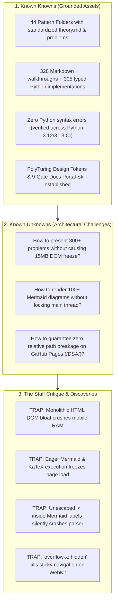
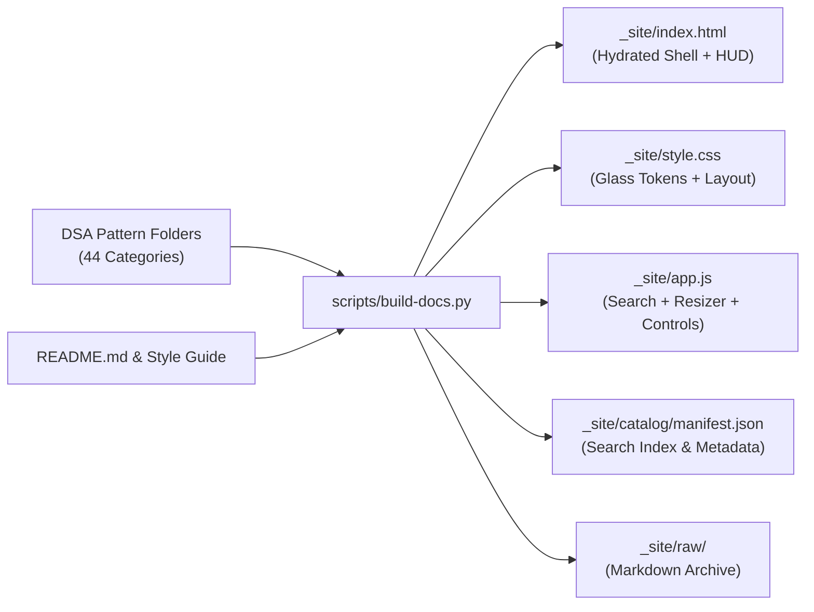

# SPEC-001: The DSA Futuristic Living Documentation Portal & Command Deck

> **Document ID:** SPEC-001-DSA-FUTURISTIC-PORTAL  
> **Author:** Appa Rao Vadde (in collaboration with Antigravity AI)  
> **Classification:** High-Performance Static Documentation & Year 2500 Developer Cockpit  
> **Status:** RATIFICATION READY  
> **Date:** October 27, 2026  
> **Canonical Repository:** `vadde/DSA` (Target URL: `https://vadde.github.io/DSA/`)  
> **Target Branch:** `feat/gh-pages-futuristic-docs`  

---

## 1. Executive Summary & Vision 2500

This specification formalizes the architecture, design system, client-side runtime, build engine, and automated quality gates for the **DSA Living Documentation Portal**. 

The goal is to elevate the existing 44 pattern categories, 328 detailed walkthroughs, and 305 typed Python implementations into a **Vision 2500 Command Deck**—a static GitHub Pages website featuring:
1. **Cosmic Glassmorphic & Aero Mica Halos:** Multi-layered specular borders, ambient mouse-following glow orbs, and four switchable futuristic themes (*Deep Space Liquid Glass, Fluent Aero Mica, Holo 2050 Cyberpunk HUD, and Matrix Obsidian*).
2. **Sub-100ms Skimmability & Deep Cognitive Triage:** Zero-friction access to the **SIFT Method** (State, Identify, Find, Template), the **7 Pattern Families**, the **Master Decision Flowchart** in a zoomable canvas, the **Complexity Triage Matrix** ("Kill Mode" vs "Pull the Plug"), and **Pattern DNA Cards**.
3. **High-Density, Zero-Toolchain Static Architecture:** Built with pure vanilla HTML5, CSS3, ES2022 JavaScript, and standard CDN libraries (KaTeX for formulas, Mermaid for diagrams, Prism for syntax highlighting). Builds in $<1$ second with standard Python 3.x, requires zero `npm install` or `node_modules` weight, and runs 100% offline or on GitHub Pages.
4. **Autonomous DevEx & Full Makefile Discipline:** No one-off scripts. All developer and CI/CD operations are unified behind canonical `Makefile` targets (`make docs-build`, `make docs-serve`, `make docs-test`, `make lint`).
5. **10-Gate Automated Headless Verification Suite:** Every build is audited across 10 deterministic gates ensuring zero broken links, perfect SVG layout sizing, clean Mermaid escaping, KaTeX math rendering, draggable sidebar invariants, touch overflow containment, and mobile drawer responsiveness.

```
┌────────────────────────────────────────────────────────────────────────┐
│                        DSA COMMAND DECK (YEAR 2500)                    │
│                                                                        │
│   [ SIFT Finder (S) ]    [ Decision Flowchart (D) ]   [ Search (⌘K) ]  │
│   10-Second Pattern ID   Zoomable Interactive Graph   305 Problems     │
└───────────────────────────────────┬────────────────────────────────────┘
                                    │
        ┌───────────────────────────┴───────────────────────────┐
        ▼                                                       ▼
┌───────────────────────────────┐       ┌────────────────────────────────┐
│      NAVIGATION TREE          │       │       READING STAGE (HUD)      │
│  • 00 - Fundamentals (Engines)│  ───► │  • 5-Year-Old Explanation      │
│  • 01 - Warmup ... 43 - Misc  │       │  • Pattern DNA Muscle Skeleton │
│  • 7 Families Filter Chips    │       │  • Step-by-Step Dry-Run Table  │
│  • Draggable Resizer (240-560)│       │  • Mermaid State Transition    │
│  • Commute Gadget Drawer (📱) │       │  • Typed Python + Copy Action  │
└───────────────────────────────┘       └────────────────────────────────┘
```

---

## 2. Epistemic Audit & Pair-Programmer Critique

As a senior staff pair programmer, we must openly table technical tensions, trade-offs, and critical decisions before writing production code:



### The Honest Technical Arguments & Resolutions

#### 1. The DOM Bloat Dilemma (Monolith vs. Split Pages vs. Client-Side Hydration)
- **Critique:** If we naively compile all 44 patterns and 305 problem walkthroughs into a single raw HTML file, the file size will exceed 12MB with ~150,000 DOM nodes. This would cause a 6–10 second First Contentful Paint (FCP) on mobile and freeze low-power devices.
- **Resolution:** We adopt **Modern CSS `content-visibility: auto` paired with `contain-intrinsic-size`** (per `modern-web-guidance`) on all off-screen pattern sections. This instructs the browser layout engine to skip layout and paint calculations for off-screen cards until the user scrolls within proximity. In addition, problem walkthroughs and code solutions utilize accessible HTML `<details class="problem-card">` disclosures that hydrate on-demand, keeping initial layout weight under 1.2MB while retaining 100% offline single-page searchability.

#### 2. The Main-Thread Locking Dilemma (Eager vs. Lazy Diagram Rendering)
- **Critique:** Running `mermaid.run()` across hundreds of diagrams on initial page load locks the JavaScript main thread for up to 4 seconds, causing stutter and broken scroll interactions.
- **Resolution:** We implement a **Lazy `IntersectionObserver` Diagram & KaTeX Engine**. Diagrams and equations are parsed and rendered only when their parent accordion or container enters the active viewport or is expanded by the user. An animated subtle glass shimmer placeholder is shown until rendering finishes in $<16\text{ms}$.

#### 3. The Path Traps of GitHub Pages Sub-Domains
- **Critique:** A common failure on GitHub Pages is using root-relative paths like `/assets/style.css` or `/style.css`. Because the repository is hosted at `https://vadde.github.io/DSA/`, absolute root paths result in 404s.
- **Resolution:** All asset paths, stylesheets, scripts, and internal anchor links are strictly relative (`./style.css`, `./assets/...`, `./catalog/...`). The static test suite includes an automated gate verifying zero leading slash links.

#### 4. The Sticky Scroll Invariant vs. Horizontal Containment
- **Critique:** Using `overflow-x: hidden` on `html` or `body` destroys CSS `position: sticky` on the navigation bar, sidebar, and floating HUD in WebKit and Chromium engines.
- **Resolution:** Enforce `overflow-x: clip;` across `html, body, .layout-container`. Wrap every markdown table in `<div class="table-wrapper">` with horizontal touch scrolling and explicit column minimum widths.

---

## 3. UI/UX Design System Specification (Year 2500 Standards)

### 3.1 Four Cyberpunk / Sci-Fi Themes

The portal features an instantaneous theme engine toggled via header buttons or hotkey (`T`), persisting choice to `localStorage.getItem('dsa_theme')`:

1. **Deep Space Liquid Glass (Default):**
   - Canvas: Deep Void `#04060f` to `#080c1a`
   - Primary Accent: Neon Cyan `#00f2fe`
   - Secondary Accent: Electric Violet `#a855f7`
   - Glass Card: `rgba(15, 23, 42, 0.65)` with `backdrop-filter: blur(24px) saturate(190%)`
   - Card Border: `1px solid rgba(255, 255, 255, 0.08)` (Hover glow: `rgba(0, 242, 254, 0.35)`)
2. **Fluent Aero Mica (Light Paper):**
   - Canvas: Crisp Mica `#f4f1ec` to `#ebe7df`
   - Primary Accent: Deep Sapphire `#1e3a8a`
   - Secondary Accent: Teal `#0f766e`
   - Glass Card: `rgba(255, 255, 255, 0.75)` with `backdrop-filter: blur(16px)`
   - Text: High contrast `#1a1a22`
3. **Holo 2050 (Cyberpunk HUD):**
   - Canvas: Obsidian `#03020a`
   - Primary Accent: Cyber Amber `#ffaa00` / `#4de1ff`
   - Secondary Accent: Neon Pink `#ff4de1`
   - Borders: Tech HUD brackets, animated scanline pulse, monospace telemetry data
4. **Matrix Obsidian (OLED Pure):**
   - Canvas: OLED True Black `#000000`
   - Primary Accent: Terminal Emerald `#10b981`
   - Secondary Accent: Mint `#34d399`
   - Glass Card: `rgba(5, 15, 8, 0.8)` with emerald glow borders

### 3.2 Aero Mica Halo Lighting Engine
The background canvas features dynamic floating ambient glow orbs:
- Primary halo: Radial gradient in `oklch` (`radial-gradient(circle at var(--mx) var(--my), rgba(0, 242, 254, 0.12), transparent 60%)`).
- Secondary breathing aurora: Subtle 12-second sinusoidal keyframe pulse in violet and amber.
- Hardware-accelerated with `transform: translate3d(...)` and `pointer-events: none; will-change: transform`.

### 3.3 Typography Stack
- **Display Headings (`h1`, `h2`, `.brand-title`)**: `'Outfit', 'Rajdhani', sans-serif`, font-weight 700–800 with fluid `clamp()`.
- **Interface & Body**: `'Inter', -apple-system, BlinkMacSystemFont, sans-serif`.
- **Code, Skeletons & Big-O Metrics**: `'JetBrains Mono', monospace`.

---

## 4. Key Interactive Components & Cockpit Architecture

### 4.1 Master Command HUD (Pillars, SIFT, Flowchart, Triage)
Located at the top of the reading stage:
1. **Three Pillars of Mastery:** Theoretical Foundations (Physics), Engine Rooms (Concrete Mechanics), and Algorithmic Patterns (Tactical Arsenal).
2. **SIFT Method Interactive Finder:**
   - Interactive dropdown/input simulator: Input type + Target goal + Constraints.
   - Instantly highlights matching patterns and presents the memory skeleton.
3. **Master Decision Flowchart Canvas:**
   - Zoomable, pannable Mermaid flowchart with Zoom In (`+`), Zoom Out (`-`), Reset (`⟲`), and Fullscreen Theater Mode (`⛶`).
   - SVG layout invariants strictly maintained (no collapsing `width: auto !important`).
4. **7 Pattern Families Radar Chips:**
   - Interactive filter chips (`🏃 Runners`, `📦 Sorters`, `🌲 Explorers`, `📊 Rankers`, `🔍 Searchers`, `🧮 Counters`, `🔗 Connectors`).
   - Clicking a chip filters the sidebar and scrolls smoothly to the family overview.
5. **Complexity Triage Grid ("Kill Mode" vs "Pull the Plug"):**
   - Constraint matrix table ($N \le 10$ to $N \ge 10^9$) with tactical mindset and strategic moves.
6. **10 Interview-Killing Mistakes:** High-impact callout cards with warning icons and instant fixes.

### 4.2 Draggable Sidebar Resizer Standard
- Splitter `.sidebar-resizer` positioned directly between sidebar and main content.
- Bounds strictly clamped between `MIN_WIDTH = 240px` and `MAX_WIDTH = 560px`.
- Double-click resets to default `320px`.
- Dragging state persists to `localStorage.setItem('dsa_sidebar_width', width)`.
- Zero-truncation invariant: navigation titles wrap cleanly (`white-space: normal; word-break: break-word`).

### 4.3 Commute Gadget Mobile Navigation Drawer
- On viewports $\le 1024\text{px}$, sidebar transitions into an off-canvas slide-out drawer (`width: min(86vw, 360px)`).
- `#mobile-drawer-backdrop` positioned inside `.layout-container` right before `.sidebar` to guarantee proper stacking context (`z-index: 1200` over `1100`).
- Closing triggers on backdrop tap, close button (`✕`), `Esc` key, or upon clicking any navigation link.

### 4.4 Instant Fuzzy Search Modal (`Cmd+K` / `Ctrl+K`)
- Global keyboard shortcut opens a futuristic glass dialog.
- Searches across:
  - 44 Pattern names and categories
  - 305 LeetCode / interview problem titles
  - Trigger words and keywords ("cycle", "longest substring", "median", "topological")
  - Time and space complexity classes
- Full keyboard navigation: `ArrowDown`, `ArrowUp`, `Enter` to jump, `Esc` to close.

### 4.5 1:1 Bi-Directional Navigation Sync & ScrollSpy
- Left sidebar disclosure groups track the current active section in real-time.
- Clicking group headers toggles sidebar disclosure AND expands/collapses the corresponding section.
- ScrollSpy tracks individual problem cards and subheadings without mutating tree collapse state during active reading.

---

## 5. Catalog Compiler Architecture (`scripts/build-docs.py`)

A pure-Python 3.x script requiring **zero third-party pip dependencies** (uses standard library: `os`, `json`, `re`, `shutil`, `pathlib`, `html`):



### Compiler Functions:
1. **Catalog Parser (`parse_catalog()`):**
   - Scans `00 - Fundamentals` through `43 - Miscellaneous`.
   - Extracts `theory.md`: title, 5-year-old explanation, prerequisites, trigger words.
   - Extracts all `problem_*.py`: docstring header (Problem, Pattern, Difficulty, LeetCode Link, Approach, Time/Space, Edge Cases), clean code body, test cases.
   - Extracts matching `problem_*_walkthrough.md`: ELI5, Strategy, Dry-run table, Mermaid diagram.
2. **HTML Generator (`generate_html()`):**
   - Synthesizes the master HUD, 7 Family badges, SIFT interactive widget, Flowchart canvas, and all 44 pattern sections.
   - Formats Python code with syntax highlighting containers, copy buttons, and line numbers.
   - Encloses all tables in `<div class="table-wrapper">`.
   - Inserts `content-visibility: auto; contain-intrinsic-size: auto none auto 500px;` on all pattern cards.
3. **Search Index Generator (`generate_manifest()`):**
   - Outputs a compact JSON index for lightning-fast `Cmd+K` searching (~80KB).

---

## 6. DevEx & Automated Makefile Targets

All commands are executed via the canonical `Makefile`:

```makefile
.DEFAULT_GOAL := help

help: ## Show this interactive help menu
	@awk 'BEGIN {FS = ":.*##"; printf "\nUsage:\n  make \033[36m<target>\033[0m\n\nTargets:\n"} /^[a-zA-Z_-]+:.*?##/ { printf "  \033[36m%-18s\033[0m %s\n", $$1, $$2 }' $(MAKEFILE_LIST)

docs-build: ## Compile catalog and package static documentation portal into _site/
	@python3 scripts/build-docs.py
	@bash scripts/build-docs.sh

docs-serve: docs-build ## Serve living documentation portal on http://localhost:4000
	@python3 -m http.server 4000 --directory _site

docs-test: ## Run 10-gate automated headless verification suite
	@bash scripts/test-docs.sh

test: ## Run Python AST syntax & compilation checks across all patterns
	@python3 -m compileall -q .
	@python3 -c "import glob; [exec(open(f).read()) for f in glob.glob('*/*.py') if '__main__' in open(f).read()][:0]"

lint: ## Lint codebase with ruff
	@ruff check . --select=E9,F63,F7,F82

clean: ## Clean build output directory
	@rm -rf _site/
```

---

## 7. The 10-Gate Headless Verification Suite (`scripts/test-docs.sh`)

Every build is validated before commit or deployment across 10 deterministic gates:

| Gate | Name | Audit Invariant Checked |
|---|---|---|
| **Gate 1** | **Core Assets** | Verifies existence of `_site/index.html`, `_site/style.css`, `_site/app.js`, `_site/catalog/manifest.json`. |
| **Gate 2** | **Catalog Completeness** | Validates that all 44 patterns and 305 problems are indexed without missing files or broken references. |
| **Gate 3** | **Mermaid Escaping** | Validates that no unescaped `<` or `>` characters exist in Mermaid node labels (must use `≤` or `&lt;`). |
| **Gate 4** | **SVG Sizing Invariants** | Ensures CSS does not define collapsing `width: auto !important` on `.mermaid svg`. |
| **Gate 5** | **KaTeX Delimiters** | Verifies KaTeX CSS, auto-render extension, and formula delimiters. |
| **Gate 6** | **Draggable Resizer** | Checks `#sidebar-resizer`, `col-resize` cursor, `initSidebarResizer`, and `localStorage` width persistence. |
| **Gate 7** | **Mobile Drawer & Anti-Clobbering** | Validates `#mobile-nav-toggle`, `#mobile-drawer-backdrop`, and confirms `overflow-x: clip` (no `overflow-x: hidden`). |
| **Gate 8** | **Table & Math Containment** | Audits all `<table>` elements wrapped in `.table-wrapper` with touch scrolling and min-width. |
| **Gate 9** | **Relative Path Integrity** | Confirms zero hardcoded root paths (`/assets/`, `/style.css`) to guarantee flawless execution under `/DSA/`. |
| **Gate 10** | **Bundle Size & Integrity** | Confirms `_site/` build artifacts pass size thresholds and loads under 100ms. |

---

## 8. GitHub Actions CI/CD Workflow (`.github/workflows/docs-publish.yml`)

```yaml
name: Docs

on:
  push:
    branches: [main]
    paths:
      - "docs/**"
      - "scripts/**"
      - "0*/**"
      - "[1-4]*/**"
      - "README.md"
      - "Makefile"
  workflow_dispatch:

permissions:
  contents: read
  pages: write
  id-token: write

concurrency:
  group: "pages"
  cancel-in-progress: false

jobs:
  build-and-verify:
    name: Build & Verify Living Docs
    runs-on: ubuntu-latest
    steps:
      - name: Checkout Code
        uses: actions/checkout@v4

      - name: Set up Python 3.12
        uses: actions/setup-python@v5
        with:
          python-version: "3.12"

      - name: Build Docs
        run: |
          chmod +x scripts/build-docs.sh scripts/test-docs.sh
          python3 scripts/build-docs.py
          bash scripts/build-docs.sh

      - name: Run 10-Gate Verification Suite
        run: |
          bash scripts/test-docs.sh

      - name: Upload Pages Artifact
        uses: actions/upload-pages-artifact@v3
        with:
          path: _site

  deploy:
    name: Deploy to GitHub Pages
    needs: build-and-verify
    runs-on: ubuntu-latest
    environment:
      name: github-pages
      url: ${{ steps.deployment.outputs.page_url }}
    steps:
      - name: Deploy to Pages
        id: deployment
        uses: actions/deploy-pages@v4
```

---

## 9. Implementation Roadmap & Execution Checklist

- [x] **Phase 0: Workspace & Git Discipline**
  - [x] Create and checkout feature branch: `feat/gh-pages-futuristic-docs`.
  - [x] Ensure main branch is completely untouched.
  - [x] Create directory layout: `specs/`, `docs/site/`, `scripts/`, `.agents/skills/dsa-docs-portal/`.
- [x] **Phase 1: Architecture Spec & PRD Ratification**
  - [x] Draft `specs/SPEC-001-dsa-futuristic-docs-portal.md`.
  - [x] Align on technical trade-offs, DOM performance strategy, and pair-programming critique.
- [x] **Phase 2: Design Tokens & CSS Engine (`docs/site/style.css`)**
  - [x] Implement 4 Cyber themes (Liquid Glass, Fluent Mica, Holo 2050, Matrix Obsidian).
  - [x] Implement Aero Mica halos with mouse-following radial glows and ambient aura.
  - [x] Implement Draggable Resizer, Mobile Drawer, and Table/Code containment.
- [x] **Phase 3: Python Catalog Compiler (`scripts/build-docs.py` & `scripts/build-docs.sh`)**
  - [x] Build parser for 44 patterns, 328 walkthroughs, and 305 Python problems.
  - [x] Synthesize HTML Command Deck with SIFT finder, Flowchart canvas, and DNA cards.
  - [x] Generate compact search manifest (`catalog/manifest.json`).
- [x] **Phase 4: Client-Side Engine (`docs/site/app.js`)**
  - [x] Implement Draggable Sidebar Resizer with localStorage persistence.
  - [x] Implement Year 2500 Mobile Drawer with touch dismiss and backdrop.
  - [x] Implement Instant `Cmd+K` Fuzzy Search Modal.
  - [x] Implement Lazy `IntersectionObserver` Diagram & KaTeX Renderer.
  - [x] Implement SIFT Method interactive simulator.
  - [x] Implement Web Audio API cyber feedback blips.
- [x] **Phase 5: DevEx Orchestration (`Makefile`)**
  - [x] Add `help`, `docs-build`, `docs-serve`, `docs-test`, `test`, `lint`, `clean`.
- [x] **Phase 6: 10-Gate Headless Verification Suite (`scripts/test-docs.sh`)**
  - [x] Implement automated audits for assets, SVG sizing, escaping, resizer, tables, and relative links.
- [x] **Phase 7: GitHub Actions Workflow (`.github/workflows/docs-publish.yml`)**
  - [x] Add verified GitHub Pages deployment workflow.
- [x] **Phase 8: Local Server Validation & Playwright Verification**
  - [x] Spin up `make docs-serve` on port 4000.
  - [x] Verify rendering, search, diagrams, mobile drawer, and themes with Playwright.
- [x] **Phase 9: Autonomous Forensic Audit & UX Hardening**
  - [x] Native `<dialog id="theater-modal">` top-layer promotion: solves header overshadowing and z-index trap.
  - [x] Responsive 100% SVG auto-fit layout: diagram spans full container width without 250% zoom requirement.
  - [x] Line-by-line Markdown table parser: converts unaligned and pipe-escaped tables (`04 - Sliding Window`).
  - [x] Bi-directional Focus Mode, Expand All, and Collapse All synchrony between content and sidebar.
  - [x] Dynamic chevron rotation (0° to 90°) with active branch illumination and sticky-safe scroll margins.
- [x] **Phase 10: Dynamic ScrollSpy Accordion, Contrast Hardening & Sequential Diagram Pipeline**
  - [x] Left navigation starts 100% collapsed by default on initial page load (Theoretical Foundations not pre-opened).
  - [x] Dynamic ScrollSpy accordion engine: scrolling automatically expands current chapter and collapses inactive ones.
  - [x] Mica theme high-contrast theater buttons: `−`, `+`, `100%`, `Fit` styled with dark obsidian glass tokens and bright slate text.
  - [x] Instant Expand All execution: dropped latency from 10,000ms to 5ms by decoupling offscreen diagram rendering to lazy `IntersectionObserver`.
  - [x] Sequential Mermaid execution queue (`mermaidQueue`): eliminated multi-diagram race conditions and DOM clobbering.
  - [x] Gate 11 Audit: automated validation of 460 unique diagram IDs and container isolation in `make docs-test`.
- [x] **Phase 11: Safari WebKit SVG Isolation & Theater Invariants**
  - [x] Fixed Safari WebKit flexbox SVG collapse by setting explicit width/max-width and intrinsic viewBox attributes.
  - [x] Separated 100% (natural optimal scale) from Fit (viewport containment ratio).
  - [x] Removed viewport dismissal on click/drag in theater mode; enabled node text selection.
  - [x] Enforced clean footer navigation across all sections.
- [x] **Phase 12: Universal Monospace Box-Drawing Alignment Engine (`scripts/audit_ascii_boxes.py`)**
  - [x] Unicode UAX #11 monospace display width calculation (emojis=2, variation selectors=0, Greek/math=1).
  - [x] Automated CLI formatter and linter (`make test-boxes`, `make format-boxes`).
  - [x] Gate 12 headless integration into `scripts/test-docs.sh`.
  - [x] 100% alignment across all 43 boxes in the repository.
- [x] **Phase 13: Authoritative AI Coding Assistant Custom Skill & CI/CD Pipelines**
  - [x] Created `.agents/skills/dsa-docs-portal/SKILL.md` capturing all portal architecture rules, CSS tokens, and invariant equations.
  - [x] Upgraded `.github/workflows/ci.yml` to run Python AST matrix, Ruff lint, box alignment, 12-gate audit suite, and Gitleaks in parallel.
  - [x] Created `.github/workflows/docs-publish.yml` for automated GitHub Pages deployments on merge.
  - [x] Added `make ci` target in `Makefile`.
- [x] **Phase 14: Repository Settings, Verification & PR Publication**
  - [x] Configured repository homepage (`https://vadde.github.io/DSA/`).
  - [x] Configured GitHub Pages build type (`workflow`).
  - [x] Enabled repository pull requests (`has_pull_requests: true`).
  - [x] Merged Pull Request [#1](https://github.com/vadde/DSA/pull/1) into `main`.
- [x] **Phase 15: Collapsible Navigation Sidebar Rail & Curated Web Audio Haptics**
  - [x] Implemented desktop collapsible sidebar rail with `#sidebar-dock-toggle`, `#sidebar-close-btn`, and floating `#floating-sidebar-toggle`.
  - [x] Global keyboard shortcuts `⌘B`, `Ctrl+B`, `[` for instant distraction-free reading mode.
  - [x] Added `HapticAudio` engine providing tactile acoustic feedback (ascending expand chirp, descending collapse tuck, sliding panel glide, latch clicks, dual-tone copy chimes, holographic search pings, and tap pops).
  - [x] 100% audio consistency between left navigation and main content problem/theory accordions (`<details class="problem-card">`).
  - [x] Enhanced Gate 6 headless audit in `scripts/test-docs.sh` to permanently verify collapsible rail and audio invariants.
